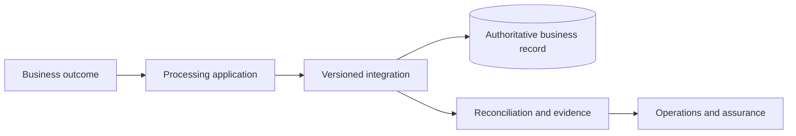

> **SYNTHETIC EXPERT EXAMPLE — NOT AN APPROVED PROJECT RECORD.** Every organisation, date, amount, performance result, evidence reference and approval below is invented for demonstration. Frameworks guide professional structure, but this document claims neither regulatory conformance nor independent expert certification. Never reuse facts as production evidence.

**Case:** Orion Payments Group · Regulated Settlement Modernisation · `OPG-RSM` · COMPLEX complexity. **Status:** illustrative proposal; L0 approval absent. **Decision/action authority:** Group Payments Executive. **Scope:** multi-jurisdiction mission-critical transformation with regulatory obligations determined per entity.

# Enterprise architecture definition — Regulated Settlement Modernisation

## Architecture context, stakeholders and boundary

The entity of interest is cross-border settlement instruction processing at Orion Payments Group; scope covers channel gateways, policy service, event ledger, settlement orchestration, regional connectors, immutable evidence store and resilience sites. Stakeholders: regional settlement owners, treasury control, compliance, SRE, data protection and independent assurance. Current baseline: regional legacy settlement engines with separate ledgers and manual end-of-day reconciliation; planned target: phased regional replacement with parallel ledger and controlled reconciliation.

Explicit exclusions: downstream third-party system internal designs and obligations not yet determined by competent legal/sector authorities. Context `OPG-RSM-CTX-01` binds business outcome `achieve complete instruction lineage and timely settlement at defined cut-offs with zero unexplained financial imbalance` to architectural concerns rather than treating a product selection as an architecture description.

## Drivers, principles and measurable requirements

Business requirement `OPG-RSM-BR-01`: achieve complete instruction lineage and timely settlement at defined cut-offs with zero unexplained financial imbalance. Quality attributes: **99.95% monthly for critical processing**, **p95 instruction acknowledgement under 450 ms excluding external networks**, **RTO 30 minutes**, **RPO 5 minutes**. These are design targets requiring source owner confirmation and acceptance tests.

Principles: avoid shared mutable state across failure domains; minimise personal data; make consequential decisions observable and reversible to a safe state; secure system boundaries by least privilege. In case of conflict, correctness and authorised use take precedence over throughput. Each principle has a waiver path through existing JAI L0 rather than silent exceptions.

## Architecture viewpoints and element identities

The views answer different stakeholder concerns and reference one identity graph, rather than maintaining duplicate objects. Business view: authorised settlement, funds release, customer notification and supervisory control, aligned to jurisdiction cut-offs. Information view: immutable instruction, amendment, finality state, jurisdiction policy, reconciliation discrepancy and retention class. Application view: channel, policy enforcement, orchestration, ledger, regional connector, supervisory reporting. Technology view: independent failure domains, HSM-backed signing boundary, durable journal, jurisdiction-resident stores and immutable evidence.

| Stable ID | Element | View | Trace relationship |
|---|---|---|---|
| `OPG-RSM-BUS-01` | Business service | Business | realises `OPG-RSM-BR-01` |
| `OPG-RSM-DATA-01` | Primary business record | Information | supports `OPG-RSM-BUS-01` |
| `OPG-RSM-APP-01` | Processing component | Application | reads/writes `OPG-RSM-DATA-01` |
| `OPG-RSM-NODE-01` | Managed runtime zone | Technology | hosts `OPG-RSM-APP-01` |

Views must reconcile their element identifiers and classification. Any view that omits a critical trust boundary is incomplete for the security stakeholder.

## Relationships, interfaces and trust boundaries

Primary path: `channel → policy-gateway → durable ingress → settlement-orchestrator → ledger + jurisdiction-connector → reconciliation/evidence`. Each cross-boundary transfer has a documented actor, direction, business key, failure strategy, residency classification and identity. API and event contracts are versioned: incompatible producers must be rejected or quarantined rather than coercing unverified data silently.

Trust boundaries: human-to-service access (enterprise authentication), service-to-service access (workload identity), external supplier integration (scoped credentials), state persistence and recoverable evidence. Enterprise trace graph relates `OPG-RSM-BR-01` → `OPG-RSM-ADR-01` → `OPG-RSM-APP-01` → `OPG-RSM-TEST-01`. These references are hypothetical but structurally meaningful.

## Target evolution, transition and operating consequences

Migration from regional legacy settlement engines with separate ledgers and manual end-of-day reconciliation to phased regional replacement with parallel ledger and controlled reconciliation must follow accepted stages: baseline and data audit; contract/model validation; non-production resilience exercise; limited wave with reconciled coexistence; operations takeover; retirement of legacy paths after retention review.

The programme has three explicit failure domains, jurisdiction-specific residency rules, intraday settlement cut-offs and an independently reconciled dual-run ledger; unsafe cross-region failover must not be assumed legal.

Transition condition: no unexplained business-record divergence, tested fallback inside 30 minutes, named data controller/residency decisions where applicable, and monitoring ownership. Architecture decision `OPG-RSM-ADR-01` records the unresolved trade-offs; this description alone is not authorisation to deploy.

### Illustrative relationship diagram (source only)

This diagram is schematic; production views must derive from stable element IDs and be checked against the canonical relationship graph.

## Evidence register, assumptions and limitations

- **OPG-RSM-E-BR — Business baseline:** verified stakeholder outcomes and data classification **Status:** proposed.
- **OPG-RSM-E-MODEL — Architecture model:** versioned canonical IDs and viewpoint relationships **Status:** illustrative.
- **OPG-RSM-E-ADR — Architecture governance:** alternative evaluation and authority decisions **Status:** pending.

Illustrative evidence IDs are internal cross-references, **not accessible customer records or claims of completed tests**. Acceptance requires attachment of real, dated evidence by the accountable role. Assumptions remain open until verified.

## Decision and downstream control

This is a proposed, non-authoritative reference. `OPG-RSM-DR-01` must be reviewed by the accountable authority and bound to a hash of the final canonical semantic record; no implied approval arises from the presence of an approval field. The owner must close material evidence gaps before using the document as the basis for deployment or risk acceptance.

**Downstream references:** OPG-RSM-HLD-01, OPG-RSM-RA-01, OPG-RSM-OPS-01. Revalidate when scope, data classification, controlling evidence or major dependencies change.

## Professional deepening: decision rationale and practical checks

### Stakeholders and architecture viewpoints

Identify stakeholders, concerns, viewpoints and views as separate concepts. A component inventory is not a set of architecture viewpoints. Map business processes to application services and technology dependencies, and explain why each selected view supports a particular decision. Define repository ownership and model revision so diagrams, tables and narrative can be traced to the same semantic identities.

### Cross-domain architecture traceability

| Architecture concern | Viewpoint | Canonical relation | Acceptance evidence |
|---|---|---|---|
| Business capability | Capability-to-service | Capability → service | Owner review of coverage |
| Trust and information | Trust-boundary/data flow | Actor → flow → control | Threat/risk assessment |
| Operational resilience | Failure-domain/dependency | Component → dependency → location | Recovery rehearsal |
| Transformation | Current/target/transition | Baseline → change → target | Migration and cutover plan |

### Non-functional design and trade-offs

State availability, latency, confidentiality, integrity, recoverability and jurisdiction constraints quantitatively where applicable; include the measurement method and operating profile. Evaluate the architectural implications of conflicting targets. For example, synchronised cross-region write confirmation may protect data integrity yet threaten the deadline for time-sensitive business processing. Record the rationale for which attribute is prioritised and under what authority.

### Current, target and transition integrity

Assign a versioned identity to each current asset and target element. Capture transition architectures explicitly rather than silently presenting the future state as implemented. The dependency plan should include data conversion, temporary controls, dual-run services, legacy retirement and the checkpoint where rollback becomes a new migration. Architecture acceptance is not proof of operational readiness.

### Architecture review objections and open decisions

Log architectural objections with affected viewpoint, violated requirement, rejected alternative and owner. The review board needs both the recommendation and the reason why apparently attractive alternatives fail. Preserve uncertainty and assumptions. Update impact analysis when source elements change, and invalidate stale published views rather than preserving a misleading “approved” diagram.

### Enterprise review challenge and operational hand-off

The reviewer should challenge the weakest evidence source before accepting the proposed conclusion, including dependency coupling, supplier exit conditions and whether ownership survives organizational change. If a required artifact is missing, record an unresolved gap rather than generating plausible-looking completion text. Translate each material concern into a downstream receiving artifact with stable ID, explicit owner and verification condition.

The following review disposition is intentionally **OPEN**: professional approval absent; operating evidence not provided; example cannot be repurposed as a production release, financial authorization or safety assurance.

