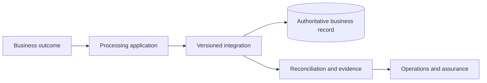

> **SYNTHETIC EXPERT EXAMPLE — NOT AN APPROVED PROJECT RECORD.** Every organisation, date, amount, performance result, evidence reference and approval below is invented for demonstration. Frameworks guide professional structure, but this document claims neither regulatory conformance nor independent expert certification. Never reuse facts as production evidence.

**Case:** Meridian Retail Group · Order Event Integration · `MRG-OEI` · MEDIUM complexity. **Status:** illustrative proposal; L0 approval absent. **Decision/action authority:** Digital Commerce Sponsor. **Scope:** multi-system integration with phased market rollout.

# Enterprise architecture definition — Order Event Integration

## Architecture context, stakeholders and boundary

The entity of interest is cross-channel order ingestion and fulfilment synchronisation at Meridian Retail Group; scope covers commerce platform, API gateway, event broker, integration workers, ERP and observability stack. Stakeholders: e-commerce product owner, ERP owner, regional fulfilment teams and support. Current baseline: nightly ERP batch exports with fragile point-to-point integrations; planned target: managed event backbone and decoupled ERP adapters.

Explicit exclusions: downstream third-party system internal designs and obligations not yet determined by competent legal/sector authorities. Context `MRG-OEI-CTX-01` binds business outcome `move accepted-order visibility from the next batch cycle to 5 minutes at p95, without losing order records` to architectural concerns rather than treating a product selection as an architecture description.

## Drivers, principles and measurable requirements

Business requirement `MRG-OEI-BR-01`: move accepted-order visibility from the next batch cycle to 5 minutes at p95, without losing order records. Quality attributes: **99.9% measured monthly**, **p95 event-to-ERP availability under 5 minutes**, **RTO 2 hours**, **RPO 15 minutes**. These are design targets requiring source owner confirmation and acceptance tests.

Principles: avoid shared mutable state across failure domains; minimise personal data; make consequential decisions observable and reversible to a safe state; secure system boundaries by least privilege. In case of conflict, correctness and authorised use take precedence over throughput. Each principle has a waiver path through existing JAI L0 rather than silent exceptions.

## Architecture viewpoints and element identities

The views answer different stakeholder concerns and reference one identity graph, rather than maintaining duplicate objects. Business view: order capture, allocation, fulfilment and refund; each market has a business owner. Information view: order, order-line, customer pseudonymous ID, fulfilment event and reconciliation exception. Application view: commerce, broker, adapter, ERP, service dashboard. Technology view: multi-zone broker, encrypted topics, service identities, regional logs.

| Stable ID | Element | View | Trace relationship |
|---|---|---|---|
| `MRG-OEI-BUS-01` | Business service | Business | realises `MRG-OEI-BR-01` |
| `MRG-OEI-DATA-01` | Primary business record | Information | supports `MRG-OEI-BUS-01` |
| `MRG-OEI-APP-01` | Processing component | Application | reads/writes `MRG-OEI-DATA-01` |
| `MRG-OEI-NODE-01` | Managed runtime zone | Technology | hosts `MRG-OEI-APP-01` |

Views must reconcile their element identifiers and classification. Any view that omits a critical trust boundary is incomplete for the security stakeholder.

## Relationships, interfaces and trust boundaries

Primary path: `commerce-api → transactional outbox → event-broker → idempotent ERP-adapter → reconciliation-store`. Each cross-boundary transfer has a documented actor, direction, business key, failure strategy, residency classification and identity. API and event contracts are versioned: incompatible producers must be rejected or quarantined rather than coercing unverified data silently.

Trust boundaries: human-to-service access (enterprise authentication), service-to-service access (workload identity), external supplier integration (scoped credentials), state persistence and recoverable evidence. Enterprise trace graph relates `MRG-OEI-BR-01` → `MRG-OEI-ADR-01` → `MRG-OEI-APP-01` → `MRG-OEI-TEST-01`. These references are hypothetical but structurally meaningful.

## Target evolution, transition and operating consequences

Migration from nightly ERP batch exports with fragile point-to-point integrations to managed event backbone and decoupled ERP adapters must follow accepted stages: baseline and data audit; contract/model validation; non-production resilience exercise; limited wave with reconciled coexistence; operations takeover; retirement of legacy paths after retention review.

Wave 1 covers two markets and the ERP adapter, then four groups of countries; country routing and customer-data minimisation must be verified separately before each promotion.

Transition condition: no unexplained business-record divergence, tested fallback inside 2 hours, named data controller/residency decisions where applicable, and monitoring ownership. Architecture decision `MRG-OEI-ADR-01` records the unresolved trade-offs; this description alone is not authorisation to deploy.

### Illustrative relationship diagram (source only)

This diagram is schematic; production views must derive from stable element IDs and be checked against the canonical relationship graph.

## Evidence register, assumptions and limitations

- **MRG-OEI-E-BR — Business baseline:** verified stakeholder outcomes and data classification **Status:** proposed.
- **MRG-OEI-E-MODEL — Architecture model:** versioned canonical IDs and viewpoint relationships **Status:** illustrative.
- **MRG-OEI-E-ADR — Architecture governance:** alternative evaluation and authority decisions **Status:** pending.

Illustrative evidence IDs are internal cross-references, **not accessible customer records or claims of completed tests**. Acceptance requires attachment of real, dated evidence by the accountable role. Assumptions remain open until verified.

## Decision and downstream control

This is a proposed, non-authoritative reference. `MRG-OEI-DR-01` must be reviewed by the accountable authority and bound to a hash of the final canonical semantic record; no implied approval arises from the presence of an approval field. The owner must close material evidence gaps before using the document as the basis for deployment or risk acceptance.

**Downstream references:** MRG-OEI-HLD-01, MRG-OEI-RA-01, MRG-OEI-OPS-01. Revalidate when scope, data classification, controlling evidence or major dependencies change.
