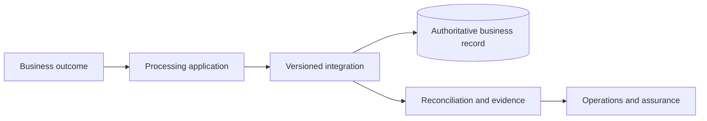

> **SYNTHETIC EXPERT EXAMPLE — NOT AN APPROVED PROJECT RECORD.** Every organisation, date, amount, performance result, evidence reference and approval below is invented for demonstration. Frameworks guide professional structure, but this document claims neither regulatory conformance nor independent expert certification. Never reuse facts as production evidence.

**Case:** Harborline Field Services · Field Appointment Reliability · `HFS-FAR` · SIMPLE complexity. **Status:** illustrative proposal; L0 approval absent. **Decision/action authority:** Field Operations Manager. **Scope:** single-business-unit, low-coupling rollout.

# Enterprise architecture definition — Field Appointment Reliability

## Architecture context, stakeholders and boundary

The entity of interest is technician appointment scheduling at Harborline Field Services; scope covers one internal scheduling service, managed identity provider, dispatch integration and managed booking SaaS. Stakeholders: dispatch supervisor, technician, service-desk operator. Current baseline: a shared spreadsheet and a single legacy dispatch application; planned target: managed scheduling SaaS with a one-way dispatch sync.

Explicit exclusions: downstream third-party system internal designs and obligations not yet determined by competent legal/sector authorities. Context `HFS-FAR-CTX-01` binds business outcome `reduce appointment rework from an illustrative 2.3% to at most 0.5% within two quarters` to architectural concerns rather than treating a product selection as an architecture description.

## Drivers, principles and measurable requirements

Business requirement `HFS-FAR-BR-01`: reduce appointment rework from an illustrative 2.3% to at most 0.5% within two quarters. Quality attributes: **99.5% per calendar month**, **p95 booking response below 2 seconds**, **RTO 8 hours**, **RPO 24 hours**. These are design targets requiring source owner confirmation and acceptance tests.

Principles: avoid shared mutable state across failure domains; minimise personal data; make consequential decisions observable and reversible to a safe state; secure system boundaries by least privilege. In case of conflict, correctness and authorised use take precedence over throughput. Each principle has a waiver path through existing JAI L0 rather than silent exceptions.

## Architecture viewpoints and element identities

The views answer different stakeholder concerns and reference one identity graph, rather than maintaining duplicate objects. Business view: dispatcher allocates work and customer receives confirmation. Information view: appointment, technician, location and customer notification. Application view: scheduling UI, managed SaaS, connector. Technology view: enterprise SSO, SaaS APIs and managed outbound queue.

| Stable ID | Element | View | Trace relationship |
|---|---|---|---|
| `HFS-FAR-BUS-01` | Business service | Business | realises `HFS-FAR-BR-01` |
| `HFS-FAR-DATA-01` | Primary business record | Information | supports `HFS-FAR-BUS-01` |
| `HFS-FAR-APP-01` | Processing component | Application | reads/writes `HFS-FAR-DATA-01` |
| `HFS-FAR-NODE-01` | Managed runtime zone | Technology | hosts `HFS-FAR-APP-01` |

Views must reconcile their element identifiers and classification. Any view that omits a critical trust boundary is incomplete for the security stakeholder.

## Relationships, interfaces and trust boundaries

Primary path: `dispatch-ui → booking-api → appointment-store → notification-worker`. Each cross-boundary transfer has a documented actor, direction, business key, failure strategy, residency classification and identity. API and event contracts are versioned: incompatible producers must be rejected or quarantined rather than coercing unverified data silently.

Trust boundaries: human-to-service access (enterprise authentication), service-to-service access (workload identity), external supplier integration (scoped credentials), state persistence and recoverable evidence. Enterprise trace graph relates `HFS-FAR-BR-01` → `HFS-FAR-ADR-01` → `HFS-FAR-APP-01` → `HFS-FAR-TEST-01`. These references are hypothetical but structurally meaningful.

## Target evolution, transition and operating consequences

Migration from a shared spreadsheet and a single legacy dispatch application to managed scheduling SaaS with a one-way dispatch sync must follow accepted stages: baseline and data audit; contract/model validation; non-production resilience exercise; limited wave with reconciled coexistence; operations takeover; retirement of legacy paths after retention review.

Scope is limited to one business team; separation between booking and notification flows prevents an outage of messaging from corrupting appointments.

Transition condition: no unexplained business-record divergence, tested fallback inside 8 hours, named data controller/residency decisions where applicable, and monitoring ownership. Architecture decision `HFS-FAR-ADR-01` records the unresolved trade-offs; this description alone is not authorisation to deploy.

### Illustrative relationship diagram (source only)

This diagram is schematic; production views must derive from stable element IDs and be checked against the canonical relationship graph.

## Evidence-led expert review supplement (v2.3.0)

> **Editorial status:** reviewer-designed example content for the fictional `HFS-FAR` context. No underlying customer system, security test, supplier quote or sign-off was inspected. This section is an illustrative professional decision aid, not completed assurance.

### Context-specific decision and evidence matrix

| Evaluation object | Explicit verification question | Evidence to request | Required disposition |
|---|---|---|---|
| Stakeholder concern and viewpoint | Is this statement supported for `HFS-FAR` by a source-controlled input with an identified owner? | Source record, scope identifier, timestamp and version | OPEN until attributable evidence exists |
| Canonical element relationship | Is the claim testable against a falsifiable success or failure criterion? | Expected/observed values and independent review result | NOT_EXECUTED if no actual test or review |
| Architecture transition and fitness check | Does the proposed conclusion change a decision, cost, permission or release condition? | Approval or refusal recorded in the existing JAI authority mechanism | PENDING, never inferred approval |

### Technical expert challenge — implementable contract

Specify the business invariant, interface/state schema, trust boundary, failure mode and explicit test oracle before claiming build readiness. For **architecture-definition**, the reviewer should actively challenge **stakeholder concern and viewpoint** and **canonical element relationship**. A plausible narrative without attributable source material remains a proposed hypothesis.

### Management challenge — trace to executable evidence

Link requirement → design choice → acceptance scenario → expected business output; HTTP status alone does not demonstrate correct business processing. The accountable party for this illustrative acceptance is **Technical Lead / Independent QA**, not an unspecified project team. Required management decision: **DEFER external commitment or release when a material evidence gap remains**. Create a tracked action with named owner, due date, acceptance predicate and escalation path; none is asserted as completed here.

### Presentation and reader decision check

**Decision headline:** evidence is insufficient for an unconditional approval; the current proposal is fit for discussion and refinement only. **What matters now:** stakeholder concern and viewpoint, canonical element relationship, and architecture transition and fitness check. **Next step:** obtain original evidence, reconcile contradictory figures and issue an updated, independently reviewed version. Use descriptive heading hierarchy, non-colour-only statuses, concise table labels, explicit units and a separate annex for technical detail. Do not bury exceptions below a visually positive summary.

### Decision-oriented quality acceptance

| Test | Expected finding for this fictional example | Decision implication |
|---|---|---|
| Source fidelity | Unverified example facts are marked synthetic or assumed | No production factual claim |
| Cross-artifact consistency | IDs, scope, prices, controls and status must reconcile with linked artifacts | Any substantive mismatch requires correction |
| Independent review | No real reviewer evidence is provided | Human-approved status remains **false** |
| Publication quality | Headings, tables, links and any figures must render without truncation; validate when a renderer is present | Missing renderer = NOT_EXECUTED, not PASS |

## Evidence register, assumptions and limitations

- **HFS-FAR-E-BR — Business baseline:** verified stakeholder outcomes and data classification **Status:** proposed.
- **HFS-FAR-E-MODEL — Architecture model:** versioned canonical IDs and viewpoint relationships **Status:** illustrative.
- **HFS-FAR-E-ADR — Architecture governance:** alternative evaluation and authority decisions **Status:** pending.

Illustrative evidence IDs are internal cross-references, **not accessible customer records or claims of completed tests**. Acceptance requires attachment of real, dated evidence by the accountable role. Assumptions remain open until verified.

## Decision and downstream control

This is a proposed, non-authoritative reference. `HFS-FAR-DR-01` must be reviewed by the accountable authority and bound to a hash of the final canonical semantic record; no implied approval arises from the presence of an approval field. The owner must close material evidence gaps before using the document as the basis for deployment or risk acceptance.

**Downstream references:** HFS-FAR-HLD-01, HFS-FAR-RA-01, HFS-FAR-OPS-01. Revalidate when scope, data classification, controlling evidence or major dependencies change.

## Professional deepening: decision rationale and practical checks

### Stakeholders and architecture viewpoints

Identify stakeholders, concerns, viewpoints and views as separate concepts. A component inventory is not a set of architecture viewpoints. Map business processes to application services and technology dependencies, and explain why each selected view supports a particular decision. Define repository ownership and model revision so diagrams, tables and narrative can be traced to the same semantic identities.

### Cross-domain architecture traceability

| Architecture concern | Viewpoint | Canonical relation | Acceptance evidence |
|---|---|---|---|
| Business capability | Capability-to-service | Capability → service | Owner review of coverage |
| Trust and information | Trust-boundary/data flow | Actor → flow → control | Threat/risk assessment |
| Operational resilience | Failure-domain/dependency | Component → dependency → location | Recovery rehearsal |
| Transformation | Current/target/transition | Baseline → change → target | Migration and cutover plan |

