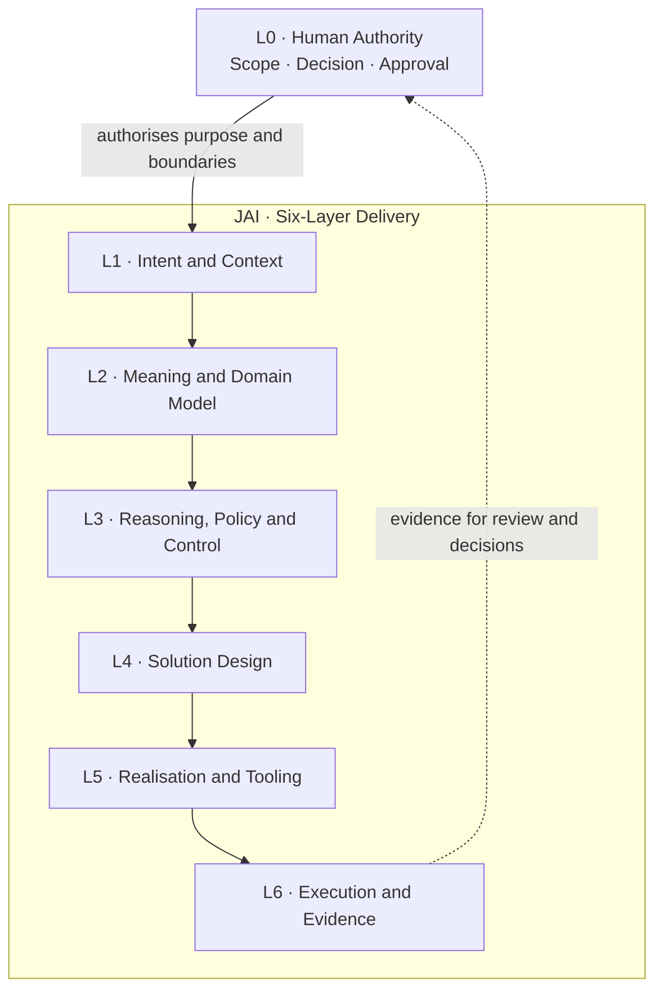

# JAI · Justifiable AI

### Human-Governed AI Augmentation for Enterprise IS/IT

**A governed, provider-neutral AI delivery system for enterprise
architecture, cybersecurity and the full IS/IT lifecycle.**

**Specialist workflows** · **Provider-neutral** · **Human-governed** ·
**Evidence-led**

JAI brings a six-layer justifiability model together with the **AI IT
House** runtime: specialist roles, typed agent contracts,
enterprise workflows, structured artifacts and release assurance.

[**Understand the model**](#the-six-layer-model) · [**Explore
capabilities**](#what-jai-enables) · [**Get
started**](#documentation-and-runtime-entry-points) · [**Find the
documentation**](#documentation-and-runtime-entry-points) · [**Release
assurance**](#quality-provenance-and-release-assurance)

---

## Human-Governed AI Augmentation

JAI helps architects, engineers and security teams produce specialist
work
with traceable reasoning, reviewable evidence and professional
deliverables.
AI prepares; accountable humans keep consequential decisions.

Start with [installation](docs/getting-started/install.md), then choose
a
[workflow](docs/getting-started/quick-start.md) in Codex or Claude. Core
workspace authoring needs neither L0 keys nor an Office renderer.

- **Evidence-backed work:** L1–L6 connect intent, meaning, policy,
design,
  realisation and execution evidence. Outputs still need appropriate
review.
- **Formal human decisions:** when configured and required, external L0
  uses an exact-state signed receipt and protected public trust. A
provider
  permission prompt is not a Fabric L0 decision.
- **Operator-assisted tasks:** if a sandbox cannot render a Word
document,
  JAI prepares an exact request. The human runs the reviewed host
renderer;
  JAI verifies returned hashes and actual pages before continuing.
Running
  a host tool does not automatically approve a Fabric decision.
- **Limits:** JAI does not certify general OS confinement, provide
  enterprise IAM or autonomously perform privileged host/API/MCP
mutations.
  Native sandbox and host permissions remain deployment
responsibilities.

See [security boundaries](docs/security/product-operations.md) for the
current limits and [the full operator
guide](docs/operations/operator-walkthrough.md)
for signed L0, real Office rendering and human Git actions.

## Why JAI exists

Enterprise IT decisions cannot rest on a fluent answer alone. They must
be **grounded in business intent, semantically consistent,
policy-conformant, reviewable and supported by evidence** — and the
resulting artifacts must be usable by the people who own the decision.

JAI is designed to move AI-assisted work beyond *prompt → response* and
toward a controlled delivery chain:

> **Intent → shared meaning → justified reasoning → solution design →
> controlled realisation → execution evidence → human decision.**

That difference matters when an output is headed to an Architecture
Review Board, a CISO, a delivery team, a risk committee or an auditor.

| Without an explicit delivery model | With the JAI approach |
| :--- | :--- |
| A plausible recommendation | A recommendation connected to intent, constraints and rationale |
| Disconnected domain-specific AI outputs | Coordinated roles, workflows and typed artifact contracts |
| An opaque sequence of tool calls | Provider execution boundaries and evidence of what actually ran |
| A polished document with unclear completeness | Publication controls and checks on the produced artifact |
| Implicit or delegated authority | **L0 human authority** remains outside the six AI layers |

**JAI is a decision-support and delivery framework, not a substitute for
accountable human ownership or approval.**

## The six-layer model

The JAI model gives each stage of AI-assisted delivery a distinct
purpose. **L0 — Human Authority** sits above the model as the external
authority and approval boundary; it is **not** a seventh JAI layer.



| Layer | The question it answers | Typical concern |
| :--- | :--- | :--- |
| **L1 — Intent and Context** | *What are we trying to achieve, and for whom?* | Business outcomes, scope, stakeholders, accountable ownership |
| **L2 — Meaning and Domain Model** | *Do we agree what the relevant concepts and requirements mean?* | Typed semantics, source context, relationships and domain models |
| **L3 — Reasoning, Policy and Control** | *Why is this acceptable, and under which rules?* | Alternatives, rationale, policy, risk, evidence obligations and escalation |
| **L4 — Solution Design** | *What should be designed and communicated?* | Architecture, artifact structure, viewpoints and publication design |
| **L5 — Realisation and Tooling** | *How is the design implemented within permitted boundaries?* | Producers, renderers, provider adapters, tools and sandboxes |
| **L6 — Execution and Evidence** | *What actually happened, and what can be verified?* | Results, validation, publication evidence, execution records and review |

**The essential separation:** domain facts, control decisions,
implementation steps and observed evidence should not be treated as
interchangeable. JAI makes their relationships explicit.

## What JAI enables

| Capability | What JAI contributes |
| :--- | :--- |
| **Enterprise architecture and security** | Coordinated expertise across business and solution architecture, **SABSA** security architecture and **EA** modelling, with business drivers, risks, controls and architectural decisions in context. |
| **End-to-end IS/IT delivery** | Specialist roles, explicit workflows and native agent/command/skill contracts spanning assessment, design, delivery, transition and operational assurance. |
| **Decision-ready artifacts** | Typed artifact contracts, semantic and publication checks, renderers and visual-quality review to support human-readable enterprise outputs. |
| **Controlled, evidence-led execution** | Provider-neutral contracts with **Claude Code** and **Codex CLI** adapters, policy boundaries, tool controls, approval paths and execution evidence. |

### A representative use case

Consider the onboarding of a business-critical cloud service. A
JAI-oriented delivery can connect the business objective to security and
privacy requirements, architecture options, SABSA/EA viewpoints, risk
treatment, implementation responsibilities and an evidence-backed review
package.

```text
Business need
   ↓
Architecture & security context
   ↓
Requirements, risks, policies and options
   ↓
Proposed design and recorded rationale
   ↓
Implementation / operational handoff
   ↓
Validation, publication and evidence
   ↓
Human review and decision
```

This is an **illustrative workflow**, not a claim that every integration
or organizational approval can be executed automatically. Available
outputs depend on the relevant contracts, configured tools and permitted
runtime access.

## Who it is for

| Audience | Practical value |
| :--- | :--- |
| **CIO / CTO / CISO and governance boards** | Decision inputs with visible assumptions, rationale, accountability and supporting evidence |
| **Enterprise, solution and security architects** | Structured domain models, traceable architectural decisions, SABSA/EA support and reusable viewpoints |
| **Programme, project and service leaders** | Coordinated IS/IT roles, delivery workflows and explicit handoff and acceptance expectations |
| **Engineering, operations and assurance teams** | Contract-driven outputs, execution boundaries, validation and records suitable for review |
| **Platform owners and maintainers** | A provider-neutral runtime, generated inventory, documentation checks and qualified release mechanisms |

## Documentation and runtime entry points

JAI has **two separate entry points**: the AI delivery runtime (used
through supported CLI providers) and the Markdown documentation site
(built with MkDocs). Building the website is **not** the same as
installing or running the AI runtime.

### 1. Start with the AI delivery runtime

Start from the provider CLI guide and runtime files described by the
project:

- `docs/reference/installed-cli-guide.md` — maintained CLI guide for
  **Claude Code** and **Codex CLI**.
- `.ai/` — runtime instructions, agent/command/skill contracts and
  tooling.
- `.ai/runtime/GUIDE.md` — generated guide copy for an installed runtime
  distribution.

Use the copies associated with your selected checkout or release
package; the source guide and its generated deployment copy serve
different purposes.

### 2. Build the documentation locally

For a source checkout, the documented local setup uses **Python 3.10+**
and repository dependencies:

```bash
git clone https://github.com/leogalambos/JAI.git
cd JAI
python3 -m venv .venv
. .venv/bin/activate
python -m pip install -r requirements.txt
mkdocs serve
```

Open the local address printed by MkDocs. To check the documentation and
its generated content, use the commands from the original project
README:

```bash
python3 .ai/runtime/tools/docs_contract.py --root .
python3 .ai/runtime/tools/generate_docs.py --check --root .
mkdocs build --strict
```

The project documentation describes Markdown sources under `docs/`,
MkDocs configuration in `mkdocs.yml`, local SVG diagrams and a separate
GitHub Pages publishing workflow. **The runtime archive does not install
a separate HTML help site.**

### 3. Repository sources versus release outputs

**Source files and generated release evidence are different
deliverables.** Release qualification and software supply-chain reports
may be included in a published package without existing as tracked files
at the GitHub repository root. Paths here are intentionally not
presented as unverified file links.

| Location or artifact | What it means | Where to look |
| :--- | :--- | :--- |
| `README.md` | Project introduction | Source repository |
| `.ai/`, `docs/`, `mkdocs.yml` | Runtime and documentation sources described by the project | Check the selected source revision |
| `docs/reference/installed-cli-guide.md` | Maintained CLI reference, per original README | Check the selected source revision |
| `.ai/runtime/GUIDE.md` | Generated deployment copy of the CLI reference | Check the installed distribution or source revision |
| `VERSION` | Documented product-version authority | Check the selected source revision |
| `QUALIFICATION-A-H.json` | Qualification record for a particular release | Published release/package evidence, **not assumed at repository root** |
| `COMPATIBILITY.json` | Compatibility report | Published release/package evidence, **not assumed at repository root** |
| `SBOM.spdx.json` | SPDX software bill of materials | Published release/package evidence, **not assumed at repository root** |
| `PROVENANCE.json` | Build and release provenance | Published release/package evidence, **not assumed at repository root** |

The documentation covers L0 authority, JAI's six layers, SABSA/EA
profiles, artifact production, publication, provider runtime boundaries
and assurance gates. References to version `26.10.0` in the source
manual are retained for identified compatibility or migration examples;
the original README identifies `VERSION` as the product-version
authority.

## Quality, provenance and release assurance

JAI treats a finished file and a trustworthy decision record as
different things. Its release qualification is organised into **eight
complementary dimensions**:

| Gate | What is assessed |
| :--- | :--- |
| **A · Structural** | Schemas, references, manifests and dependency integrity |
| **B · Semantic** | Completeness, evidence, consistency and traceability |
| **C · Governance** | Ownership, approval, separation of duties and classification |
| **D · Runtime security** | Policy, sandbox, permitted tools and provider execution boundaries |
| **E · Publication** | Projection completeness, fidelity and renderer results |
| **F · Visual** | Quality of the rendered, human-visible artifact |
| **G · Behavioral** | End-to-end scenario and output behaviour |
| **H · Supply chain** | Dependencies, compatibility, integrity and release provenance |

The release process describes qualification, compatibility, SPDX SBOM
and provenance evidence. **Do not assume these JSON files are present at
the root of the source branch**: inspect the actual release package or
published evidence for the version in use. A prior PASS does not certify
a modified source tree.

### Releasing a version (maintainers)

The project identifies `VERSION` as the product-version authority. After
changing it, synchronise versioned files:

```bash
python3 scripts/versioning.py sync
```

Commit and push the result. Wait for the `validate-library` workflow,
including its full A-H release preflight, to pass before creating a
matching `release@YY.MM.VV` tag. The preflight runs the same
qualification command as the release workflow without publishing a
release. A
mismatching tag is rejected. The release GitHub Actions workflow
publishes a qualified production ZIP and a SHA-256 checksum; GitHub OIDC
provenance is attached where supported. Documentation publishing is
managed separately by the documented `.github/workflows/pages.yml`
workflow, using the Markdown documentation tree. Installing the runtime
ZIP does not publish the site.

---

<!-- GENERATED-INVENTORY:START -->
## Current generated release inventory

This block is generated from canonical package sources by
`.ai/runtime/tools/generate_docs.py`. Manual count edits are not
authoritative.

Supported scope: **GA_COMPATIBLE/2**.

Enabled features: `role-workflows`, `workspace-authoring`,
`local-publication`, `human-git`, `operator-handoff`,
`operator-attested-local-l0`.

- Roles: **286**
- Agents: **34**
- Skills: **24**
- Workflows: **24**
- Artifact Types: **28**
- Schemas: **33**
- Renderers: **4**
- Tests: **32**
- Provider Adapters: **2**

### Compatibility matrix

- **Claude Code**
  - Minimum: provider-supported strict sandbox
  - Tested: not installed on reference host; projections only, live
    NOT_VERIFIED
  - Supported: contract-scoped tools; reviewer shell unavailable without
    read-only isolation
- **Codex CLI**
  - Minimum: provider-supported
  - Tested: 0.164.0 host CLI help confirms sandbox/on-request values;
    live role confinement NOT_VERIFIED
  - Supported: role-authorized local QA in effective native sandbox
- **Python**
  - Minimum: 3.10
  - Tested: 3.12 release CI target
  - Supported: yes
- **Pandoc**
  - Minimum: optional
  - Tested: publication tool detects at runtime
  - Supported: optional
- **WeasyPrint**
  - Minimum: 70.x optional
  - Tested: actual HTML/PDF conversion; constrained resource fetching
  - Supported: SUPPORTED optional HTML/PDF; not Office fidelity
- **Pyphen**
  - Minimum: 0.17.x optional
  - Tested: clean optional renderer environment required; metadata
    inspection avoids legacy pkg_resources import
  - Supported: WeasyPrint transitive dependency constrained in
    requirements-rendering.txt
- **LibreOffice**
  - Minimum: Office-compatible host renderer
  - Tested: actual DOCX/PPTX/XLSX operator renders on Fedora
  - Supported: AUTO when native sandbox permits; otherwise
    OPERATOR_ASSISTED actual Office QA
- **Poppler**
  - Minimum: pdftoppm on PATH
  - Tested: actual PDF page rasterization
  - Supported: visual QA raster prerequisite
- **OpenSSL**
  - Minimum: Ed25519 pkeyutl -rawin
  - Tested: external receipts verified with fixed /usr/bin/openssl on
    Linux
  - Supported: OPERATOR_ASSISTED local L0; other trust adapters
    NOT_VERIFIED
- **Fonts/system libraries**
  - Minimum: DejaVu Sans; renderer-native text/layout libraries
  - Tested: Fedora reference glyph/layout corpus
  - Supported: host prerequisite; other platforms NOT_VERIFIED
- **lxml**
  - Minimum: 5.x
  - Tested: XSD conformance suite
  - Supported: EA conformance
- **jsonschema**
  - Minimum: 4.x
  - Tested: Draft 2020-12
  - Supported: semantic schemas
- **Pillow**
  - Minimum: runtime-supported
  - Tested: visual QA fixture rendering
  - Supported: visual QA
- **GitHub Actions**
  - Minimum: release workflow
  - Tested: tag, A-H gates, ZIP SHA-256, CI publication
  - Supported: automatic release publication
<!-- GENERATED-INVENTORY:END -->

---

<div align="center">

**JAI · Justifiable AI** *Not simply an AI-generated answer — a
traceable path from intent to evidence and accountable decisions.*

[Architecture](#the-six-layer-model) · [Getting
started](#documentation-and-runtime-entry-points) · [Quality &
releases](#quality-provenance-and-release-assurance)

</div>


Documentation owner: JAI maintainers. Last reviewed: 2026-10-26.
