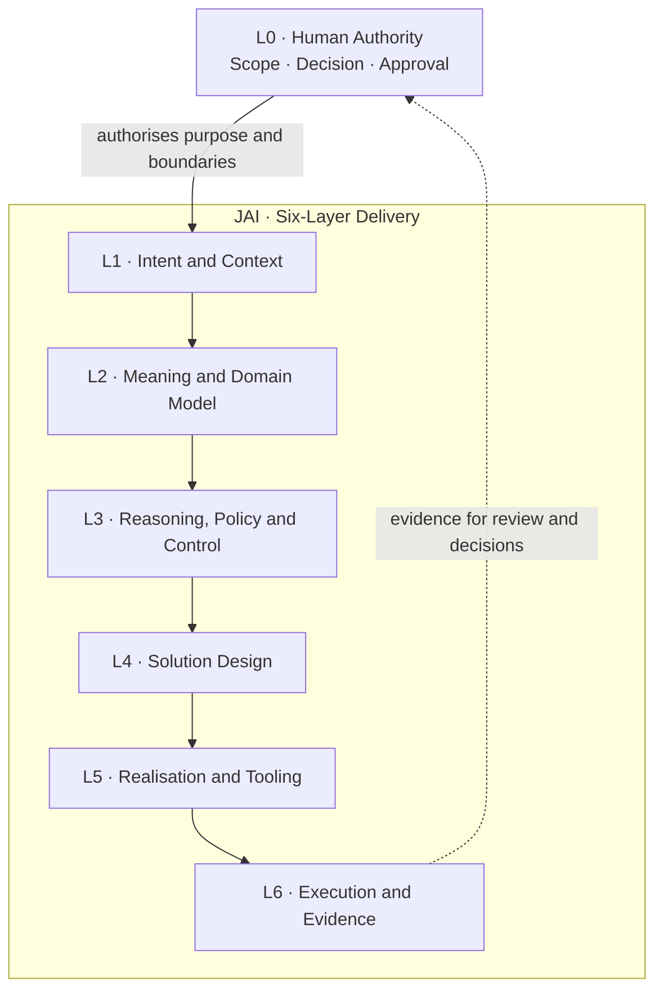

<div align="center">

# JAI · Justifiable AI

### From enterprise intent to decisions you can explain, evidence, and reproduce.

**A governed, provider-neutral AI delivery system for enterprise architecture, cybersecurity and the full IS/IT lifecycle.**

**Enterprise GA** · **Provider-neutral** · **Human-governed** · **Evidence-led**

JAI brings a six-layer justifiability model together with the **AI IT House** runtime: specialist roles, executable agent contracts, enterprise workflows, structured artifacts and release assurance.

[**Understand the model**](#the-six-layer-model) · [**Explore capabilities**](#what-jai-enables) · [**Get started**](#get-started) · [**Read the manual**](docs/) · [**Release assurance**](#quality-provenance-and-release-assurance)

</div>

---

## Why JAI exists

Enterprise IT decisions cannot rest on a fluent answer alone. They must be **grounded in business intent, semantically consistent, policy-conformant, reviewable and supported by evidence** — and the resulting artifacts must be usable by the people who own the decision.

JAI is designed to move AI-assisted work beyond *prompt → response* and toward a controlled delivery chain:

> **Intent → shared meaning → justified reasoning → solution design → controlled realisation → execution evidence → human decision.**

That difference matters when an output is headed to an Architecture Review Board, a CISO, a delivery team, a risk committee or an auditor.

| Without an explicit delivery model | With the JAI approach |
| :--- | :--- |
| A plausible recommendation | A recommendation connected to intent, constraints and rationale |
| Disconnected domain-specific AI outputs | Coordinated roles, workflows and typed artifact contracts |
| An opaque sequence of tool calls | Provider execution boundaries and evidence of what actually ran |
| A polished document with unclear completeness | Publication controls and checks on the produced artifact |
| Implicit or delegated authority | **L0 human authority** remains outside the six AI layers |

**JAI is a decision-support and delivery framework, not a substitute for accountable human ownership or approval.**

## The six-layer model

The JAI model gives each stage of AI-assisted delivery a distinct purpose. **L0 — Human Authority** sits above the model as the external authority and approval boundary; it is **not** a seventh JAI layer.



| Layer | The question it answers | Typical concern |
| :--- | :--- | :--- |
| **L1 — Intent and Context** | *What are we trying to achieve, and for whom?* | Business outcomes, scope, stakeholders, accountable ownership |
| **L2 — Meaning and Domain Model** | *Do we agree what the relevant concepts and requirements mean?* | Typed semantics, source context, relationships and domain models |
| **L3 — Reasoning, Policy and Control** | *Why is this acceptable, and under which rules?* | Alternatives, rationale, policy, risk, evidence obligations and escalation |
| **L4 — Solution Design** | *What should be designed and communicated?* | Architecture, artifact structure, viewpoints and publication design |
| **L5 — Realisation and Tooling** | *How is the design implemented within permitted boundaries?* | Producers, renderers, provider adapters, tools and sandboxes |
| **L6 — Execution and Evidence** | *What actually happened, and what can be verified?* | Results, validation, publication evidence, execution records and review |

**The essential separation:** domain facts, control decisions, implementation steps and observed evidence should not be treated as interchangeable. JAI makes their relationships explicit.

## What JAI enables

<table>
<tr>
<td width="50%" valign="top">

### Enterprise architecture and security

Apply coordinated expertise across business and solution architecture, **SABSA** security architecture and **EA** modelling. Keep business drivers, risks, controls, designs and architectural decisions connected to their context.

</td>
<td width="50%" valign="top">

### End-to-end IS/IT delivery

Use defined specialist roles and workflows across assessment, design, implementation, transition and operational assurance. Agent, command and skill contracts make responsibilities more explicit than a collection of free-form prompts.

</td>
</tr>
<tr>
<td valign="top">

### Decision-ready artifacts

Produce governed enterprise artifacts using typed contracts, semantic and publication controls, renderers and visual-quality checks. The intention is an output that is **useful to its audience**, not merely syntactically valid.

</td>
<td valign="top">

### Controlled, evidence-led execution

Use provider-neutral contracts with native **Claude Code** and **Codex CLI** adapters. Keep policy, tooling, approvals, execution evidence and release qualification visible and reviewable.

</td>
</tr>
</table>

### A representative use case

Consider the onboarding of a business-critical cloud service. A JAI-oriented delivery can connect the business objective to security and privacy requirements, architecture options, SABSA/EA viewpoints, risk treatment, implementation responsibilities and an evidence-backed review package.

```text
Business need
   ↓
Architecture & security context
   ↓
Requirements, risks, policies and options
   ↓
Proposed design and recorded rationale
   ↓
Implementation / operational handoff
   ↓
Validation, publication and evidence
   ↓
Human review and decision
```

This is an **illustrative workflow**, not a claim that every integration or organizational approval can be executed automatically. Available outputs depend on the relevant contracts, configured tools and permitted runtime access.

## Who it is for

| Audience | Practical value |
| :--- | :--- |
| **CIO / CTO / CISO and governance boards** | Decision inputs with visible assumptions, rationale, accountability and supporting evidence |
| **Enterprise, solution and security architects** | Structured domain models, traceable architectural decisions, SABSA/EA support and reusable viewpoints |
| **Programme, project and service leaders** | Coordinated IS/IT roles, delivery workflows and explicit handoff and acceptance expectations |
| **Engineering, operations and assurance teams** | Contract-driven outputs, execution boundaries, validation and records suitable for review |
| **Platform owners and maintainers** | A provider-neutral runtime, generated inventory, documentation checks and qualified release mechanisms |

## Get started

There are **two different entry points**: use the AI delivery runtime, or run the documentation site locally.

### 1. Use the AI delivery runtime

Start with the **[Installed CLI Guide](docs/reference/installed-cli-guide.md)**. It is the maintained guide for the native Claude Code and Codex CLI command/skill integrations.

Runtime definitions live under [`.ai/`](.ai/), where the providers load operational contracts. The checked deployment copy of the guide is [`.ai/runtime/GUIDE.md`](.ai/runtime/GUIDE.md); its maintained source is the Markdown manual, not an installed HTML site.

> **Important:** The MkDocs commands below run the *documentation*, not the AI IT House execution runtime. Provider-specific runtime setup and invocation belong in the Installed CLI Guide.

### 2. Read or develop the documentation

Requirements: **Python 3.10+** and the dependencies declared by this repository.

```bash
git clone https://github.com/leogalambos/JAI.git
cd JAI
python3 -m venv .venv
. .venv/bin/activate
python -m pip install -r requirements.txt
mkdocs serve
```

Open the local address printed by MkDocs. For a strict documentation build and contract check:

```bash
python3 .ai/runtime/tools/docs_contract.py --root .
python3 .ai/runtime/tools/generate_docs.py --check --root .
mkdocs build --strict
```

The documentation is authored as **Markdown under [`docs/`](docs/)**, with navigation in [`mkdocs.yml`](mkdocs.yml), and rendered using **MkDocs Material**. The site uses HTML/CSS composition and local SVG architecture/workflow visuals where practical; Mermaid remains configured for other diagrams. The runtime ZIP does **not** install a separate HTML help site.

## How the repository is organised

| Path | Purpose |
| :--- | :--- |
| [`.ai/`](.ai/) | Runtime instructions, agent/command/skill contracts, policies and tooling |
| [`docs/`](docs/) | Maintained human-readable documentation and reference material |
| [`docs/reference/installed-cli-guide.md`](docs/reference/installed-cli-guide.md) | Canonical provider CLI user guide |
| [`mkdocs.yml`](mkdocs.yml) | Documentation navigation and site configuration |
| [`requirements.txt`](requirements.txt) | Python dependencies used by the documented build |
| [`VERSION`](VERSION) | Sole authority for the current product version |
| [`QUALIFICATION-A-H.json`](QUALIFICATION-A-H.json) | Recorded qualification evidence for the release scope |
| [`COMPATIBILITY.json`](COMPATIBILITY.json) | Release compatibility information |
| [`SBOM.spdx.json`](SBOM.spdx.json) | Software bill of materials |
| [`PROVENANCE.json`](PROVENANCE.json) | Build/release provenance information |

The full manual covers L0 authority, L1–L6 contracts and evidence flow, SABSA and EA profiles, artifact production and publication, runtime boundaries, release gates and production workflows. **`26.10.0` references in the manual are retained for explicitly identified compatibility and migration examples; the root `VERSION` controls the current product identity.**

## Quality, provenance and release assurance

JAI treats a finished file and a trustworthy decision record as different things. Its release qualification is organised into **eight complementary dimensions**:

| Gate | What is assessed |
| :--- | :--- |
| **A · Structural** | Schemas, references, manifests and dependency integrity |
| **B · Semantic** | Completeness, evidence, consistency and traceability |
| **C · Governance** | Ownership, approval, separation of duties and classification |
| **D · Runtime security** | Policy, sandbox, permitted tools and provider execution boundaries |
| **E · Publication** | Projection completeness, fidelity and renderer results |
| **F · Visual** | Quality of the rendered, human-visible artifact |
| **G · Behavioral** | End-to-end scenario and output behaviour |
| **H · Supply chain** | Dependencies, compatibility, integrity and release provenance |

Release materials include qualification, compatibility, an SPDX SBOM and provenance records. **Always assess evidence against the exact source revision or distribution being used**: a prior PASS does not certify a modified tree.

### Releasing a version (maintainers)

The root [`VERSION`](VERSION) is authoritative. After changing it, synchronise versioned files:

```bash
python3 scripts/versioning.py sync
```

Commit/push the result, then create a matching `release@YY.MM.VV` tag. A mismatching tag is rejected. The release GitHub Actions workflow publishes a qualified production ZIP and a SHA-256 checksum; GitHub OIDC provenance is attached where supported. Documentation publishing is managed separately by [`.github/workflows/pages.yml`](.github/workflows/pages.yml), using the Markdown documentation tree. Installing the runtime ZIP does not publish the site.

---

<!-- GENERATED-INVENTORY:START -->
## Current generated release inventory

This block is generated from canonical package sources by
`.ai/runtime/tools/generate_docs.py`. Manual count edits are not
authoritative.

- Roles: **281**
- Agents: **33**
- Skills: **23**
- Workflows: **24**
- Artifact Types: **28**
- Schemas: **32**
- Renderers: **4**
- Tests: **32**
- Provider Adapters: **2**

### Compatibility matrix

- **Claude Code**
  - Minimum: provider-supported
  - Tested: adapter contract
  - Supported: yes
- **Codex CLI**
  - Minimum: provider-supported
  - Tested: adapter contract
  - Supported: yes
- **Python**
  - Minimum: 3.10
  - Tested: 3.12 release CI target
  - Supported: yes
- **Pandoc**
  - Minimum: optional
  - Tested: publication tool detects at runtime
  - Supported: optional
- **LibreOffice**
  - Minimum: optional
  - Tested: publication tool detects at runtime
  - Supported: publication
- **lxml**
  - Minimum: 5.x
  - Tested: XSD conformance suite
  - Supported: EA conformance
- **jsonschema**
  - Minimum: 4.x
  - Tested: Draft 2020-12
  - Supported: semantic schemas
- **Pillow**
  - Minimum: runtime-supported
  - Tested: visual QA fixture rendering
  - Supported: visual QA
- **GitHub Actions**
  - Minimum: release workflow
  - Tested: tag, A-H gates, ZIP SHA-256, CI publication
  - Supported: automatic release publication
<!-- GENERATED-INVENTORY:END -->

---

<div align="center">

**JAI · Justifiable AI**  
*Not simply an AI-generated answer — a traceable path from intent to evidence and accountable decisions.*

[Architecture](#the-six-layer-model) · [Runtime guide](docs/reference/installed-cli-guide.md) · [Documentation](docs/) · [Quality & releases](#quality-provenance-and-release-assurance)

</div>
