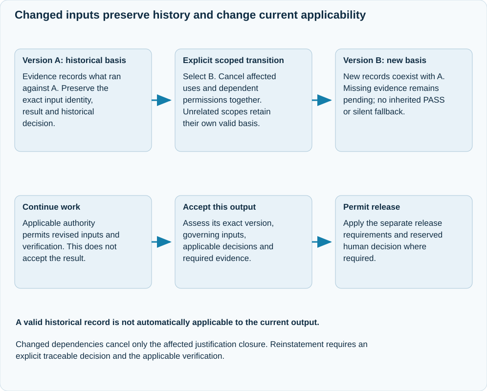

# Versioned inputs and current applicability

A mutable file path is a locator, not the identity of an input. JAI records
immutable versions of the material relevant to a claim, execution, review or
decision. The logical identity identifies what a record is about; its version
identity identifies the exact recorded content and dependencies.

## Input change and scoped applicability

{ .ai-concept-svg }

[Open the full-size diagram](../assets/diagrams/gen2-input-applicability.svg). On narrow screens, focus the diagram and scroll horizontally.

The two versions coexist. Cancelling current reliance does not change the historical execution result. Continuation permits work on B; acceptance and release require their own current supporting basis. Unrelated outputs retain their applicable evidence.

## Historical truth and current use

An earlier test result can remain a truthful account of its execution while
no longer supporting a changed output. Integrity, validity for its original
inputs, applicability to an output and permission to use it are separate questions.

Historical records are not rewritten. New inputs and conclusions create new
records. Different conclusions over the same inputs can coexist; conflicts need
explicit assessment rather than selection solely by timestamps or hashes.

## Explicit replacement

A replacement decision identifies the affected records, input versions and scope,
the dependent conclusions and permissions that lose applicability, and the
replacement records. Cancellation and new selection commit as one transition.
The replacement is not automatically verified or accepted.

If the current selection lacks required evidence, there is no valid current
basis. JAI must not silently fall back to a superseded predecessor. Reinstatement
requires an explicit decision and satisfaction of the applicable verification
requirements.

## Relevant dependency closure

Current-basis queries assess a particular output version against its governing
inputs, required evidence, qualified reviews and applicable decisions. Changed
dependencies invalidate affected applicability without globally invalidating
unrelated evidence. Reviews and positive results do not transfer automatically
to changed inputs.

An obsolete record outside an output's relevant dependency closure does not
block the entire system. Missing, invalid, revoked or insufficient evidence
required by that output continues to block its acceptance or release.

## Continued work is not acceptance

An authorised input update can permit new work and verification even when
previous conclusions have become obsolete. It grants neither acceptance of
the new result nor release permission. Reserved human decisions remain bound
to their exact signed effects, scope, expiry and expected state.

Unsupported historical storage formats remain archives. A new engagement does
not inherit their verification or acceptance. See
[recording and recovery](governed-runtime-recording.md).
