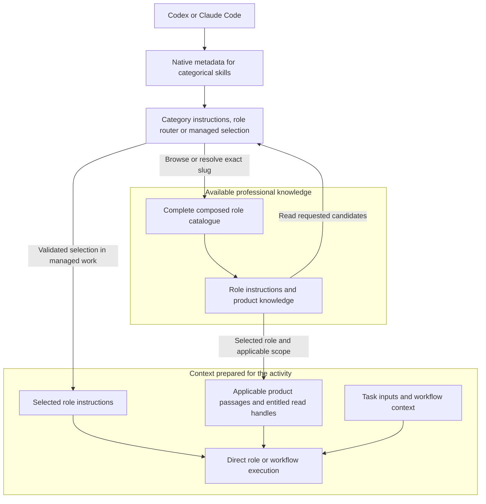

# Hierarchical Role Discovery and Context Scalability

JAI decouples the size of its professional role catalogue from the initial
native skill listing in Codex and Claude Code. A host discovers a relatively
small set of categorical skills, while JAI keeps individual roles in a
catalogue with reference files. An activity can select the roles and knowledge
it needs. The complete catalogue remains available for controlled exploration
during applicable selection phases.

The current composed installation contains **314 professional roles in 17
role-bearing categorical skills**, including 28 product specializations. The
base source registry contains 286 entries. Composition adds the specialist
entries and the installer projects the resulting catalogue and references.
These counts describe the current distribution. The 17 categories are one
part of the host's native skill inventory, which can also include JAI
workflow skills, reusable operator skills and other installed skills.
[Role catalogue](../reference/roles.md) ·
[Installation](../getting-started/install.md) ·
[Composition source](https://github.com/leogalambos/JAI/blob/main/tools/compose_role_library.py) ·
[Installer source](https://github.com/leogalambos/JAI/blob/main/.ai/setup/installer.py)

## Architecture and responsibilities

| Layer | Responsibility |
| --- | --- |
| Host CLI integration | Codex or Claude Code discovers native skills and supplies the model, host tools, permissions and context management. |
| Categorical skills | Each role-bearing `SKILL.md` introduces a professional domain and directs the host to role references. Native Agent Skills provide the host integration and initial discovery surface. |
| Role discovery and resolution | The router matches a task to a professional remit. JAI's managed runtime builds catalogue views, validates exact role identifiers and applies assignment eligibility where configured. |
| Professional role catalogue | The composed registry associates slugs, names, aliases, deliverables and tool tiers with exact role reference files. Each reference defines the professional scope, inputs, methods and checks. |
| Contextual instructions | The selected role supplies professional instructions. Product-specific knowledge can add concrete practices and evidence requirements. Managed preparation applies captured scope to classified passages and reference reads. |
| Task execution | A direct role, named workflow or layered assignment uses the selected instructions within its own output, tool and authority boundaries. |

A native Agent Skill is a host-recognized package with its own `SKILL.md`. A
JAI role is a professional definition that an operator or workflow may select.
Multiple roles share a category and may use the same operator. A role does
not imply an independently running agent, a separate model instance or
execution authority. The discovery layers below describe context assembly
across the supported entry points. They are distinct from the six SABSA
content layers. [Role router source](https://github.com/leogalambos/JAI/blob/main/.ai/agents/role-router.md) ·
[Usage modes](../using/usage-modes.md) · [Native provider execution](gen2-native-execution-bridge.md)

The catalogue and the references remain available as data. The model receives
the metadata, records and instruction text that the host or workflow actually
presents. The diagram shows possible reads and context assembly, rather than
automatic traversal of every catalogue entry.

## Discover and resolve a role

### Explicit selection

An operator can name the IBM QRadar SIEM Integration Specialist or request
`qradar-siem-specialist`. The same applies to
`java-software-engineering-specialist`. In direct use, the category and the
router can find the name or alias in the installed
`~/.ai/it-role-house/roles.json` and open the reference recorded for that role.
Use the slug when names or aliases overlap. The router checks the requested
deliverable, scope boundary and activation criteria before selecting it.

In managed selection, the returned specialty must use the exact catalogue
`row.slug`. The runtime checks that the slug occurs in the captured instruction
map and in the eligible set when the assignment has one. Given the same
captured catalogue and an accepted exact slug, lookup identifies a single
instruction record. The language model's choice of a suitable role from prose
is a separate decision. A fixed workflow binding or scoped eligibility policy
can limit which roles may be selected for an assignment.
[Specialization profiles](../reference/product-specializations.md) ·
[Managed routing source](https://github.com/leogalambos/JAI/blob/main/.ai/runtime/tools/governed_routing.py)

### Task-oriented discovery and exploration

When an operator describes the work instead of naming a role, the direct role
router uses the requested deliverable and professional scope to choose
candidates. It can inspect the installed JSON catalogue and role references.
The composed distribution also contains exact-slug and facet indexes. Their
presence does not imply that every host or workflow runs an automatic search
against them. The host and router can use permitted local tools to inspect
structured data without sending every role definition to the model.
[Role router source](https://github.com/leogalambos/JAI/blob/main/.ai/agents/role-router.md) ·
[Index generation](https://github.com/leogalambos/JAI/blob/main/tools/compose_role_library.py)

Managed native selection has a concrete Python implementation. It groups
the available rows by category and builds pages of six summary entries,
with separate references for full records and instructions. A page size
limits an individual page, while further pages remain available to the
chooser. When a governed workflow has scoped eligibility, Python builds
the view from the eligible slugs. Reviewed specialist policies can filter
on the exact workflow endpoint, responsibility, product, edition, version
and deployment, role availability and independence. With no specialist
policy, exact workflow bindings can still apply. These are deterministic
constraints and navigation. The model interprets the mandate, explores
relevant candidates and returns its selection. JAI does not implement a
general semantic role-ranking service in this path.
[Native delivery resource assembly](https://github.com/leogalambos/JAI/blob/main/.ai/runtime/tools/governed_native_provider.py) ·
[Workflow eligibility source](https://github.com/leogalambos/JAI/blob/main/.ai/runtime/tools/workflow_role_selection.py)

Selection has intrinsic broker handles for the captured catalogue and exact
role instruction files. Ordinary managed selection presents navigation for the whole
catalogue. A scoped selection can present a narrower eligible list while
retaining the intrinsic selection reads. Eligibility governs which choice
the runtime accepts.

The hardened filesystem worker exposes the catalogue as `/catalogue/catalogue.json`
and uses `/catalogue/instructions/<slug>.md` for references when the
phase permits them. Native provider presentation uses navigable resources
and handles. These are distinct access mechanisms, and the literal mount
path is not a portable native CLI path. Current managed work exposes the
selected projected instructions. Access to the full catalogue belongs to
selection and other paths that explicitly expose it.

Reading the whole catalogue through a model-visible tool can still
consume substantial context. So can reading every category page or
opening many candidates.
[Managed workflow operating guide](../operations/normal-layered-workflow.md#model-facing-context) ·
[Worker sandbox and catalogue mount](https://github.com/leogalambos/JAI/blob/main/.ai/runtime/tools/governed_dispatch.py)

## Progressive disclosure by execution mode

1. The host discovers native skill metadata.
2. The host loads the chosen categorical skill instructions when used.
3. The category, role router or managed selection phase resolves the role.
4. The activity obtains the selected professional instructions.
5. Applicable product-specific knowledge is delivered inline or read from
   a relevant reference, according to the entry point and scope.
6. The activity proceeds with its task inputs, tools and output contract.

The sequence describes the common information flow. An explicit role can
skip category browsing, and a managed parent can present its own selection
resources to a local entity.

| Mode | How information reaches the model |
| --- | --- |
| Direct Codex | The installer places categorical skills in the Codex skill tree with role references below them. It also projects JAI operator and workflow entry points as separate skills. Codex starts with skill metadata and loads the chosen `SKILL.md` when it uses the skill. The router or category then directs the model to the role and applicable product references. |
| Direct Claude Code | The installer supplies categorical skills and separate Claude agent and command artifacts. In a regular session Claude initially uses descriptions and loads full skill content on invocation. Claude also documents explicit full-skill preloading for configured subagents. The direct JAI category and role references guide the model to product knowledge applicable to the work. |
| Managed JAI layered execution | The parent enrolls the catalogue, role instructions and guarded references as captured material. Local selection receives navigable catalogue resources under the applicable rights. Work receives the selected professional instructions and applicable references. Codex and Claude have distinct carrier artifacts and invocation shapes. |

In the direct installations, the provider-facing role reference leads to a
knowledge index when classified guidance is deferred. The model follows
the listed applicability when opening a reference. Managed work applies
deterministic scope checks. For a classified passage, every declared
dimension must match within one captured target. For example, Java API
documentation guidance can require the Java product and the
`java-api-documentation` activity. Unresolved applicability does not grant
a match. Inapplicable passages are removed from the prepared role text and
their read handles are withheld. An enabled, bounded discovery view can
describe potentially relevant deferred references so the required scope
can be resolved. Discovery metadata does not grant a read.
[Installer projection](https://github.com/leogalambos/JAI/blob/main/tools/generate_infrastructure_guidance.py) ·
[Scope projection](https://github.com/leogalambos/JAI/blob/main/.ai/runtime/tools/governed_routing.py) ·
[Codex Skills](https://developers.openai.com/codex/skills/) ·
[Claude Code skill content lifecycle](https://code.claude.com/docs/en/skills#skill-content-lifecycle)

## Context scalability

Let **N** be the number of available professional roles, **C** the number of
natively registered role-bearing categorical skills and **K** the number
of roles selected for an activity. Under a flat one-role-per-skill design,
the potential initial role-discovery metadata grows approximately with
**N** for comparable entries, before host-specific caps, truncation and
omission. JAI's initial role-discovery metadata depends primarily on **C**
and the size of each category's metadata. The host still lists its other
skills separately.

Keeping category metadata bounded lets the catalogue grow within existing
categories without adding one native registration per new role. This
reduces pressure on native skill-listing budgets while preserving full
catalogue availability for applicable selection work. A category's full
`SKILL.md` body can still grow if its reference table grows. A managed
invocation can also spend context on catalogue data it returns, the **K**
selected instructions, matching product knowledge, task materials and
accumulated conversation. No fixed token cost follows from **C** or **K** alone.

| Catalogue scenario | Available roles N | Flat role-discovery entries before host limits | JAI category entries C |
| --- | ---: | ---: | ---: |
| Current composed distribution | 314 | 314 | 17 |
| Hypothetical catalogue | 1,000 | 1,000 | 17 if the same categories suffice |
| Hypothetical catalogue | 5,000 | 5,000 | 17 if the same categories suffice |
| Hypothetical catalogue | 10,000 | 10,000 | 17 if the same categories suffice |

The hypothetical rows illustrate how registrations scale under stated
assumptions. They are neither measured capacities nor operational guarantees.

| Architectural property | Flat one-role-per-native-skill registration | JAI hierarchical role discovery |
| --- | --- | --- |
| Native registration granularity | Individual professional role | Professional category |
| Initial discovery metadata | Potentially grows with the number of roles | Primarily follows the number and size of category entries |
| Professional knowledge loading | On demand through native skills | On demand through category navigation, exact role references and managed selection |
| Catalogue exploration | Depends on the host and package design | JAI registry and managed navigation during applicable selection |
| Product specialization | Depends on skill and host implementation | Reference applicability in direct use and captured-scope filtering in managed work |
| Catalogue extensibility | One registration per role under this design | Roles can be added within existing categories |

Native Agent Skills themselves support progressive disclosure and bundled
references. JAI applies that mechanism and extends it with a professional
catalogue, exact role identities and assignment-specific preparation.
[Agent Skills specification](https://agentskills.io/specification)

## Trade-offs and limits

| Concern | Current safeguard or constraint | Possible next step for larger deployments |
| --- | --- | --- |
| Search and resolution cost | Python assembles category pages and validates captured rows. A workflow can filter eligible roles. The snapshot and view construction still process catalogue data. | Measure catalogue load, capture, lookup and view construction on representative installations before changing indexing or caching. |
| Large model-visible reads | Managed native views split summaries and details. Dispatch applies response budgets. A complete catalogue read can still be large or exceed a configured bound. | Measure context cost per selection and evaluate narrower query interfaces where needed. |
| Ambiguous roles and taxonomy drift | Exact slugs, discipline and remit checks, composed ancestry and validated output-contract bindings provide stable identity and scope. Aliases can overlap. | Maintain taxonomy ownership, review near-duplicates and track unresolved ambiguous selections. |
| Instruction consistency and multiple roles | Specialists inherit professional controls and outputs. Managed validation checks role eligibility and assignment boundaries, and local author and reviewer contexts remain distinct. Selection does not automatically reconcile all overlapping instructions. | Define precedence or separate assignments when selected professional remits conflict. |
| Long-running context | Managed execution prepares fresh task-specific work contexts and can reuse valid staffing decisions. Direct session history and repeated reads can accumulate. | Observe session context growth and deliberate handoff or compaction behaviour on each host. |
| Host differences | Provider projections and invocation shapes differ, and each host controls skill listing, permissions and context. | Qualify both hosts with realistic tasks, configurations and catalogue sizes. |

The principal scalability work therefore moves toward catalogue maintenance,
resolution quality and controlled context consumption. Total execution cost
still depends on catalogue reads and preparation, workflow history and the
actual host behaviour. No performance result here establishes support for
1,000 or more roles.

## Verification and evidence

| Evidence | What it establishes |
| --- | --- |
| Composed catalogue and installation source | 314 unique roles across 17 categorical skills. The installer supplies both provider projections from the same composition. |
| Installation observations for the current catalogue | All 314 Codex role references were checked on disk. Installer state recorded all 314 role reference destinations for Claude. A fresh Codex App Server skills listing found the role router and the QRadar category skill. |
| Maintained offline routing and transport tests | Tests exercise complete catalogue capture, exact resolution, navigation, workflow eligibility, context filtering and byte-budget rejection. Both provider shapes are exercised offline. The maintained default full-catalogue budget test uses the 286-role source registry fixture. |
| Live provider limits | Installer records identify projected destinations. Offline Claude invocation tests establish intended transport. Equivalent live Claude Code specialist discovery and execution has not been independently qualified in the maintained evidence reviewed for this chapter. The Codex App Server observation covers skill discovery. |
| Capacity limits | The architecture separates registration counts from catalogue size. The hypothetical sizes above remain untested capacity assumptions. |

[Installer tests](https://github.com/leogalambos/JAI/blob/main/tests/test_installer.py) ·
[Native provider tests](https://github.com/leogalambos/JAI/blob/main/tests/test_governed_native_provider.py) ·
[Managed routing tests](https://github.com/leogalambos/JAI/blob/main/tests/test_governed_routing.py) ·
[Offline carrier tests](https://github.com/leogalambos/JAI/blob/main/tests/test_governed_native_batches.py) ·
[Deployment qualification](../getting-started/deployment-notes.md) ·
[Execution and context assembly](../overview/execution-context-algorithm.md)
