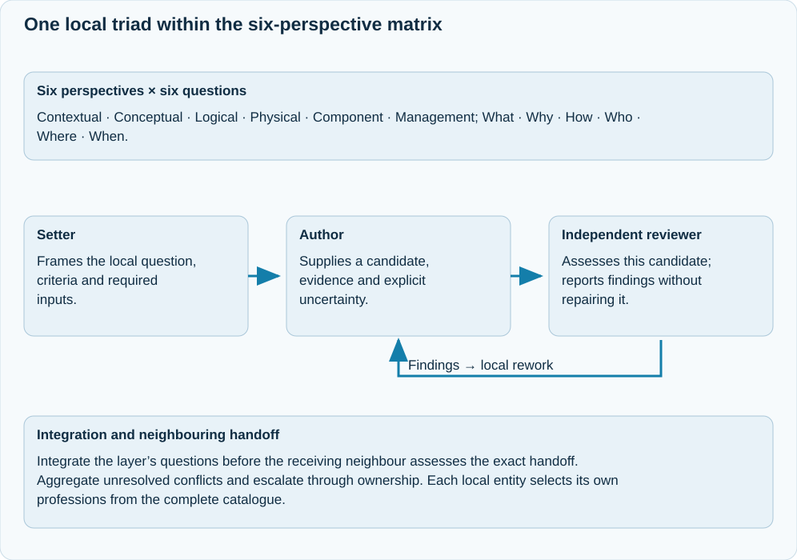

# SABSA-layer delivery model

JAI organises consequential work using six content perspectives and six questions.
The organising matrix does not itself prove completeness or formal SABSA
conformance; substantive content, traceability and appropriate review are required.

## Content perspectives

| Layer | Responsibility |
| --- | --- |
| L1 Contextual | Business purpose, stakeholders, assets, environment, scope, required qualities, constraints and success measures |
| L2 Conceptual | Principles, domains, trust, strategies, business attributes and control objectives derived from context |
| L3 Logical | Technology-independent services, information, interactions and control behaviour |
| L4 Physical | Concrete technical and organisational mechanisms that realise logical functions |
| L5 Component | Detailed components, interfaces, configuration and implementation within the physical design |
| L6 Management | Governance, assurance, operation, monitoring, support, maintenance, resilience and improvement |

Every perspective addresses **What, Why, How, Who, Where and When** at its
own level. Management is crosscutting: operational needs inform earlier work,
and later findings can trigger owner-led revisions of affected requirements.

## Gen2 perspectives and local review

{ .ai-concept-svg }

[Open the full-size diagram](../assets/diagrams/gen2-local-triad.svg). On narrow screens, focus the diagram and scroll horizontally.

The matrix provides content perspectives. The local triad establishes how an exact candidate is formulated, authored and reviewed. Management concerns are crosscutting; a neighbouring layer supplies requirements and interfaces rather than appointing the local professions.

## Local responsibilities

The **setter** formulates the question and its criteria. The **author** proposes
a candidate and supporting material. An **independent reviewer** assesses the
exact candidate against those criteria and reports supported conclusions,
findings or missing evidence. Reviewers do not repair the work they judge.

Each entity selects appropriate professional specialties from the complete
catalogue. A role label supplies knowledge, not ownership or authority. The
incoming neighbour supplies outcomes and interfaces, not an imposed local
author, reviewer or working method.

Question reviews are followed by cross-question integration review. The receiving
neighbour then accepts the exact handoff for its intended use. These are distinct
decisions; the preceding layer is not automatically the professional reviewer.

## Ownership and change

The semantic owner is identified by engagement, scope, layer, question and work
item. Same-layer membership does not confer authority over another work item.
A layer can request a change to inherited inputs, but their owner must publish
the revision and its explicit cancellation effects.

L0 requirements reserved by the human remain constraints until the entitled
human changes them. JAI may explain that it has not found a satisfactory solution;
that is not proof that no solution exists.

## Progress and escalation

Work advances through exact versioned inputs, reviewed answers and accepted
handoffs. It can pause and resume at durable boundaries. Partial progress never
implies that unperformed work or a whole matrix is accepted.

Aggregate unresolved conflicts before escalating through adjacent ownership.
Pause affected work by default; continue speculatively only within an explicit
operator-approved scope and budget. Preserve rejected attempts, uncertainty and
historical decisions without granting permission to reuse invalidated results.

See the [operating guide](../using/layered-engagement.md),
[delivery profile](../reference/sabsa-delivery-profile.md) and
[versioned lifecycle](governed-runtime-cutover.md).
