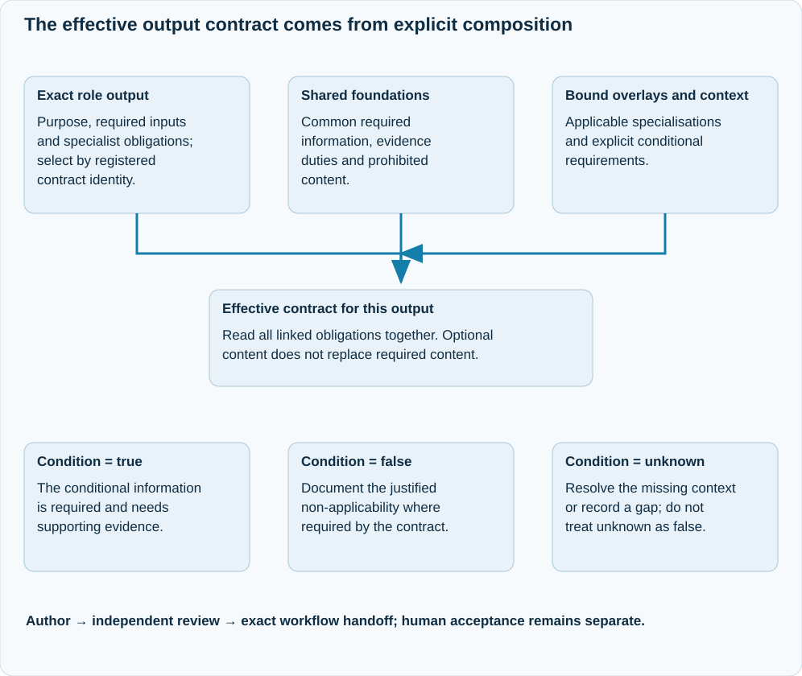

# Output content specifications

JAI specifies work products through content contracts. A contract explains the
information or behaviour required of an output, its inputs, conditions,
evidence, acceptance criteria and professional basis. It covers documents,
models, code, tests, configuration, operational records and performed work.

Start with the [output contract catalogue](../reference/output-contracts/index.md).
The [role catalogue](../reference/roles.md) links each primary deliverable to its
exact contract. The [workflow catalogue](../reference/workflows.md) links stage
outputs to their contracts and states the receiving condition.

## How an effective output contract is selected

<div class="ai-diagram ai-diagram-inline" markdown="1">
<div class="ai-diagram-scroll" role="region" tabindex="0" aria-label="Scrollable diagram: How an effective output contract is selected" markdown="1">

{ .ai-concept-svg }

</div>
</div>

[Open the full-size diagram](../assets/diagrams/gen2-effective-output-contract.svg). On narrow screens, focus the diagram and scroll horizontally.

Read the selected contract together with its named foundations and overlays. Context determines conditional applicability; it does not silently remove required content. The reviewer assesses the actual output and evidence, separately from any human acceptance or release decision.

## Required, conditional and optional content

Each output selects an explicit content specification and its effective shared
foundations and overlays. Read them together: local requirements supplement the
linked shared requirements. A similar title does not establish that another
contract applies.

- **Required information (MUST)** identifies concrete information, relationships,
  behaviour or observed results that the selected contract requires.
- **Conditionally required information** states its applicability condition.
  When the condition is true, the information is required. Unknown applicability
  remains unresolved; it cannot silently be treated as false.
- **Optional information (MAY)** is included when it supports the purpose and
  audience. An optional annex cannot replace required analysis.
- **Prohibited content (MUST NOT)** must be excluded; relevance is not an exception
  to a prohibition.
- **Content to omit unless justified** identifies low-value material that may be
  retained only with a relevant justification under the selected contract.

These are semantic obligations, not instructions to add identically named
headings. Information may be supplied in prose, structured fields, executable
artefacts or references to relevant source material. A heading, a nonempty field,
a rendered document or a successful structural check does not demonstrate that
the content is correct or professionally adequate.

## Evidence, review and authority

Material claims need the evidence or explicit uncertainty specified by the
contract. Missing inputs remain gaps with an identified resolution path. An
estimated value is not an observation; planned execution is not evidence that
execution occurred.

An independent reviewer assesses the actual content and applicable criteria.
Workflow receiving conditions, human acceptance and permission to release
remain separate. A content specification or its publication grants none of
these permissions. The catalogue exposes the current proposed/advisory status
of the underlying definitions; it does not promote them to approved standards
or claim professional certification.

## Professional sources

A professional reference names its edition or framework where identified,
explains the subject it informs, and states the limits of the mapping. JAI
separates an explicitly evidenced external requirement from an informed-by
professional proposal and from a local JAI practice rule. A role's framework
bibliography provides context; it does not establish that every criterion is a
verbatim requirement of that framework.

Explicit acceptance criteria remain readable without consulting a model's
memory of a standard. Source references help the author and reviewer interpret
the professional context; they do not replace the stated criteria or establish
compliance with a complete standard.

## Selection and generated documentation

Production selection uses the registered contract ID and explicit binding.
The existing resolver can inspect a selected contract:

```sh
python3 .ai/runtime/tools/content_spec.py resolve --root . \
  --artifact-id solution-architect:1
```

The public catalogue is a generated projection of the same definitions,
inheritance, source metadata and role/workflow bindings. Refresh it with:

```sh
python3 tools/generate_output_contract_docs.py --root .
python3 tools/generate_output_contract_docs.py --root . --check
```

The generator replaces only its named marker blocks and removes obsolete pages
that carry its ownership marker. Manual prose outside those blocks is retained.
Check mode reports drift without changing files. The fast release validation
checks this projection; generating documentation does not run an engagement,
replay its history, perform review or grant authority.
