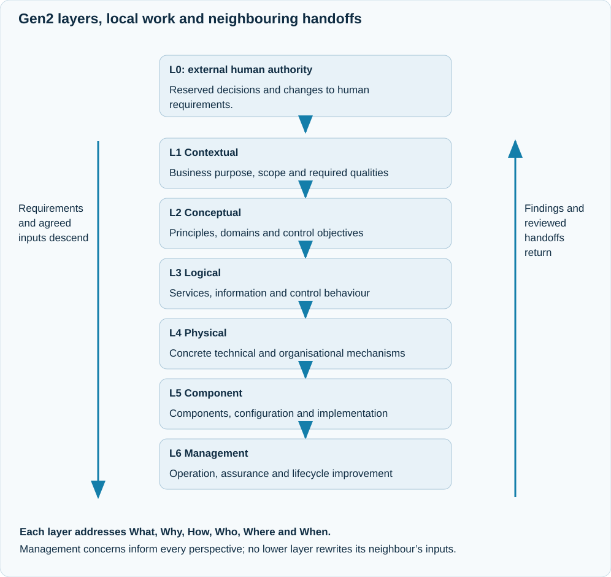

# Justifiable Fabric

The **Justifiable Fabric** records the justification for a consequential Gen2
engagement. Its append-only journal connects exact inputs, assignments, outputs,
evidence, reviews and decisions. Canonical business or architecture content
remains in the relevant domain model; the journal records how particular versions
were used and what currently follows from them.

## What the operator uses

| In the provider conversation | What JAI records or assesses |
| --- | --- |
| Claude: `/layered <intent>`; Codex: `$workflow-layered <intent>` | The task, its controlling inputs, local professional assignments and actual returned work |
| Ask for progress, missing evidence or the next action | The durable current state, unresolved dependencies and applicable local limits |
| Claude: `/fabric-report [engagement]`; Codex: `$workflow-fabric-report [engagement]` | An independent read-only assessment of the exact output, governing versions and current permissions |
| Supply revised inputs or answer an escalation | An owner-authorised revision with explicit scope and cancellation effects |
| Decide a reserved L0 matter | An exact request for external human review and signing; the agent does not sign it |

The native parent handles setup and runtime transport. Users do not prepare
bootstrap JSON, launch nested provider clients or write workers for ordinary
native use. See the [operator journey](../using/layered-engagement.md).

## Layers and local review

<div class="ai-diagram ai-diagram-inline" markdown="1">
<div class="ai-diagram-scroll" role="region" tabindex="0" aria-label="Scrollable diagram: Gen2 layers" markdown="1">

{ .ai-concept-svg }

</div>
</div>

[Open the full-size diagram](../assets/diagrams/layered-runtime-cycle.svg).
On a narrow display, focus the diagram region and scroll to read its labels.

The six perspectives are **Contextual, Conceptual, Logical, Physical, Component
and Management**. Each addresses What, Why, How, Who, Where and When at its own
level. Management concerns also apply across the other perspectives. L0 is the
external human decision boundary. See the [layer model](../architecture/sabsa-layer-model.md).

Within a layer, a setter defines the question and criteria, an author produces a
candidate, and an independent reviewer assesses it. Each entity selects suitable
specialties from the complete catalogue. Adjacent layers exchange outcomes,
requirements and interfaces; they do not choose each other's internal staff.
Cross-question integration review and receiving handoff acceptance are distinct
from the local question reviews.

## Historical truth and current justification

The journal preserves immutable versions and the decisions that established or
cancelled their applicability. A working filesystem path is a locator, not an
immutable input identity. A test result can remain a truthful historical record
while no longer justifying the changed output.

A legitimate input replacement selects the new scoped version and cancels the
affected conclusions, reviews and permissions atomically. It does not make the
replacement verified or accepted. If required current evidence is absent, there
is no valid current basis; the system must not fall back to a superseded record.
Unrelated historical material outside the assessed output's dependency closure
does not block that output. See [versioned applicability](../architecture/governed-runtime-cutover.md).

## Continued work, acceptance and release

These are separate permissions:

- **Continuation** permits specified work, including verification of updated inputs.
- **Acceptance** establishes the reviewed result for its exact intended use.
- **Release** permits the specified use or distribution of an exact output.

An authorisation to continue does not accept a result or permit release. A local
reviewer's supported conclusion does not manufacture an external human decision.
Ordinary recording and local queries require no private signing key. Only
explicit reserved L0 decisions use the external operator key and existing signed
request mechanism. Its public proof remains bound to the approved effects,
scope, expiry, request identity and expected state. See [human authority](../operations/human-authority.md).

## Rework, time limits and escalation

Rework corrects an answer against the current assignment. Reformulation changes
the question or criteria through their entitled owner; another layer cannot
silently edit inherited requirements. Unresolved issues are aggregated and
escalated through adjacent ownership. Affected work pauses by default. Speculative
continuation requires an explicit operator-approved scope and budget.

Ordinary processing has no mandatory overall task deadline. The configurable
local iteration window defaults to ten minutes across the actual setter, author
and reviewer work. Three unsuccessful semantic reworks lead to escalation. A
restart preserves an active window rather than resetting it. On expiry, JAI
reports the interrupted stage, progress, iteration and reworks used; the operator
can grant additional time or stop the work. Explicitly requested overall limits
remain possible. See the [operating guide](../operations/normal-layered-workflow.md).

## Storage and recovery

The Fabric CLI defaults to `~/.ai/fabric/<engagement>.jsonl`; `FABRIC_HOME` changes
that locator. A host adapter using an explicit Store path must use the same
engagement location consistently. Referenced immutable files live beside the
journal in its `<journal-name>.blobs/` directory. Preserve both together.

Normal processing reuses the verified journal prefix. Cold reconstruction,
explicit audit and an actual loss of trust are separate verification boundaries.
A missing or corrupt required file is an explicit failure, not permission to
substitute a mutable working file. Old engagement formats remain historical
archives; a fresh Gen2 engagement does not inherit their acceptance. See
[startup and recovery](../operations/lifecycle-recovery.md).

## Behind the scenes: maintainer interface

Ordinary users stay in the provider conversation. For host integrations and
investigation, the installed facade accepts typed messages and exact scoped
queries. The following placeholders stand for actual host-prepared files:

```sh
python3 ~/.ai/it-role-house/fabric/fabric.py validate --message /operator/message.json
python3 ~/.ai/it-role-house/fabric/fabric.py submit engagement-id --message /operator/message.json
python3 ~/.ai/it-role-house/fabric/fabric.py current-basis engagement-id --query /operator/query.json
```

Validation checks message structure and identity without recording or granting
authority. Submission checks the actual transition and returns its receipt or
rejection. An explicit L0 message additionally supplies the exact public proof
prepared by the [operator signing procedure](../operations/operator-walkthrough.md).
The read-only `status`, `verify`, `justify` and `report` commands also require
`engagement-id --query /operator/query.json`; their result is scoped to that query.
The query shape is defined by the [delivery protocol](../reference/governed-delivery-protocol.md).

## Scope of assurance

JAI uses deterministic Python state transitions, schemas and native provider
integration; it does not execute the illustrative Prolog model. Recorded
provenance establishes the actual captured scope, not hidden provider context or
arbitrary professional truth. Direct roles and workflows remain available outside
a full layered engagement. A deployment requiring layered handling must select
that route and enforce its applicable host boundaries.
