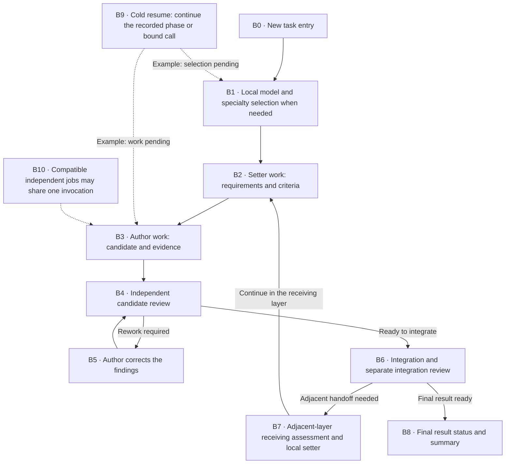

# Execution profiles and measured efficiency

Execution profiles select preferred workload classes and reasoning effort for
setters, authors and reviewers. They are operational preferences, independent of
governing JAI profiles, authority, permissions and resource allowances. Local
entities retain the full professional catalogue and may choose another available
workload when their mandate requires it.

## Conversation commands

| Operation | Claude Code | Codex |
| --- | --- | --- |
| List profiles and active source | `/jai-profile` | `$workflow-profile` |
| Select a project profile | `/jai-profile stronger-reviewer` | `$workflow-profile stronger-reviewer` |
| Inspect resolved settings | `/jai-profile effective` | `$workflow-profile effective` |
| Select for subsequent new runs in this conversation | `/jai-profile research --session` | `$workflow-profile research --session` |
| Show measured project history | `/jai-stats` | `$workflow-stats` |
| Show the last recorded run | `/jai-stats last` | `$workflow-stats last` |
| Compare profiles | `/jai-stats compare standard stronger-author` | `$workflow-stats compare standard stronger-author` |

The native agent invokes the backing Python helpers internally. Operators remain
inside the conversation; no external-console command is required. These commands
become available after the source package is installed or refreshed; source files
alone do not establish activation in an already running provider session.

## Defaults before configuration

You can start native layered work without creating a configuration file. With no
user, project, local, session or run preference, the active routing mode is
`workload`: the local entity chooses a workload class and the captured model
registry resolves it. The default named profile remains `standard`, but it is
inactive until selected or otherwise opted into.

| Setting | No configuration files or explicit selection | `standard` explicitly selected |
| --- | --- | --- |
| Active choice and mode | `workload`; `routing_mode: workload`, source `bundled` | `standard`; `routing_mode: profile`, with the selection source |
| Model routing | The selected workload's registry mapping; no uniform role model is forced. | Setter, author and reviewer prefer `standard` / `medium`; justified alternative workloads remain available. |
| Bundled provider preference | Depends on the selected workload. | Claude `sonnet` / `medium`, or Codex `gpt-6.1-sol` / `medium`. |
| Context policy | `isolated-handoffs` | `isolated-handoffs`, unless a merged context setting overrides it |
| Workers and review | New physical invocations are fresh; author and reviewer are separate. Batch members share one invocation. | The same mandatory isolation and batching rules. |
| Main conversation | Provider-managed compaction; no JAI main-chat reset. | The same behavior with the default context policy. |
| Configuration diagnostic | `configured: false` | `configured: true` |

Both cases default to `unspecified` task-class and review-scope labels. Models are
resolved through the [model registry](models.md), including deployment overrides;
actual host availability is separate. Profiles never switch automatically.

The `routing_mode` field states which routing actually applies. `configured` only
states whether an explicit preference exists: selecting `workload` sets it to
true **without activating fixed responsibility mappings**. Context-only
configuration, role overrides or a customized selected profile still opt into the
default named `standard` profile when no explicit workload selection is present.
Choose `workload` explicitly to keep class-based routing while retaining context
and other configuration. Existing engagements keep their captured settings.

## Choosing and returning to workload routing

| Choice | Claude | Codex |
| --- | --- | --- |
| Prefer balanced responsibility mappings | `/jai-profile standard` | `$workflow-profile standard` |
| Return future project runs to workload routing | `/jai-profile workload` | `$workflow-profile workload` |
| Override a project-local profile selection | `/jai-profile workload --local` | `$workflow-profile workload --local` |
| Use workload routing for subsequent new runs in this conversation | `/jai-profile workload --session` | `$workflow-profile workload --session` |

`workload` is an explicit built-in routing mode, not a fixed role profile. It
ignores fixed responsibility model/effort overrides, even when a higher-precedence
file supplies those overrides. It preserves context, analytics and custom profile
definitions. Switching to a named profile reactivates its preferences and any
applicable overrides; no configuration files need to be deleted.

A project write does not defeat a higher-precedence local **selection**. The
selection receipt shows `effective_profile`, `effective_routing_mode`, `shadowed`
and the effective context. If a local named selection wins, use `--local` or an
explicit session selection to change the active choice. Deleting one project file
would not clear inherited user or local preferences and is not a reset command.

When switching to workload routing, the current effective context is retained.
A persistent selection records an explicit context only if an inherited profile
context would otherwise change. A session selection writes no files: the parent
retains the complete selection receipt, including context, and transports both to
subsequent new starts. This also preserves an inherited context when switching
from one session-only named profile to session-only workload routing.

Use `/jai-profile effective` or `$workflow-profile effective` to inspect the
current session choice and the persisted configuration separately. Workload-mode
output includes the effective registry mappings instead of fixed responsibility
preferences. Lists identify both the active mode and the selected/default named
profile. A named profile's displayed preference is not proof that every invocation
used it; see [routing deviations](#routing-deviations-and-professional-requirements).

## How workload complexity is chosen

The classes express intended complexity; JAI has no automatic numeric difficulty
estimator that proves a task belongs to one of them.

| Class | Intended work | Signals for the local selector to assess |
| --- | --- | --- |
| `light` | Fast, bounded routing, inventory or simple structured work | Narrow scope, explicit inputs, little synthesis and readily checked output |
| `standard` | Routine professional authoring and review | Established methods, clear requirements and manageable dependencies |
| `heavy` | Difficult architecture, diagnosis, policy or consequential synthesis | Interacting constraints, difficult verification, consequential omissions or substantial integration |
| `research` | Exploratory work with high uncertainty | Competing hypotheses, unfamiliar methods, evidence gaps or novel synthesis requiring disconfirmation |

Canonical operator definitions declare `model_class` as a default for their
projections and ordinary use. For example, the role router declares `light`, the
role author declares `standard`, and the SABSA architect declares `research`.
Projection code uses the registry's `fallback_class` (`standard` in the bundle)
only if no class is declared; this is not a difficulty assessment.

In native layered work, each actual local entity receives the captured full
provider/workload availability. Its selection phase chooses specialties, a class
and its matching model, with an explicit reason. The runtime validates and records
that choice. Work projections then use the **selected class**, rather than silently
replacing it with the operator's canonical default. Applicable recorded plans are
reused instead of running selection again for unchanged assignments.

The native bootstrap and selection chooser use the captured `light` mapping.
That keeps choosing bounded; it does not make all subsequent work light. A workload
mode maps the actual selected class directly through the captured registry,
including its declared effort and administrator overrides. A named profile
substitutes its model/effort preference when the matching responsibility selects
that profile's preferred class; other class choices remain available. Declared
fallbacks are not proof of host availability or evidence that a fallback was
actually served.

## Built-in choices

Each cell is workload class / effort. These seven named profiles express
preferences. The separate `workload` mode has no fixed role preference. All use
`isolated-handoffs` by default, unless an explicit or preserved context overrides
it. Effort levels are not equivalent across models or providers.

| Profile | Setter | Author | Reviewer |
| --- | --- | --- | --- |
| `standard` | standard / medium | standard / medium | standard / medium |
| `stronger-reviewer` | standard / high | standard / medium | heavy / high |
| `stronger-author` | standard / high | heavy / high | standard / medium |
| `stronger-setter` | heavy / high | standard / medium | standard / high |
| `high-assurance` | heavy / high | heavy / high | heavy / high |
| `economy` | standard / medium | light / medium | standard / medium |
| `research` | research / high | research / xhigh | heavy / high |

**Standard** suits routine, bounded work where creation and verification need a
balanced investment. It is a useful explicit baseline for comparing like tasks.

**Stronger setter** suits ambiguous goals, complicated interfaces or acceptance
criteria whose omissions could send all later work in the wrong direction. More
authoring effort cannot repair an incorrectly formulated requirement by itself.

**Stronger author** suits difficult construction or synthesis with sufficiently
clear criteria. It invests earlier to reduce the chance of costly reconstruction,
while the reviewer still performs the required independent professional assessment.

**Stronger reviewer** suits outputs that are difficult to verify, where domain
omissions or edge cases have meaningful consequences. It invests in challenging
the candidate and its evidence; a stronger reviewer still needs adequate criteria.

**High assurance** suits substantive work with high consequences and difficult
reasoning across formulation, creation and review. The larger investment does not
guarantee correctness, waive prerequisites or grant acceptance or authority.

**Economy** suits simple, readily testable work with limited impact. It economizes
on authorship while retaining standard review; it is unsuitable when cheap creation
would merely transfer difficult unresolved reasoning to a weak checking process.

**Research** suits exploratory questions with substantial uncertainty. The author
needs to investigate alternatives and hypotheses, and the reviewer should challenge
the evidence and seek disconfirmation. Additional effort is not a guarantee of a
positive finding or successful experiment.

Prefer **workload** when task complexity varies and the local selector should use
the registered class mappings directly. Stronger models and higher effort can cost
more time and resources; no measured savings are implied by a profile name. Compare
similar work using first-pass outcomes, rework and substantive findings where
measured. Fewer findings alone do not prove quality.

Integrators and measurement operators use author preferences; integration reviewers
and receivers use reviewer preferences. These preferences do not override the
professional prerequisites described below.

## Routing deviations and professional requirements

The generic runtime requires independent author/reviewer actors and physical
contexts; it has no universal prohibition on equal model/effort tuples. A specific
professional contract can require more. [SABSA independent review](../capabilities/sabsa-ea.md#independent-review-model-prerequisite)
requires a different author/reviewer model; changing effort alone does not satisfy
that requirement. A profile is a preference and cannot waive it.

For example, if an author and reviewer would both use the same model under a
profile, the SABSA reviewer must select a compatible different model, or the review
stays blocked with inline alternatives and the next step for the same pending
assignment. Changing the profile default for future runs does not repair an
already pinned run. Registry-declared alternatives still need actual host support.

Prepared work exposes the exact captured selected workload, requested model and
effort alongside the profile preference. Started physical work invocations that
differ are counted as routing deviations; a shared batch counts once. Selection
chooser calls are excluded. A different workload counts as a deviation even when
it maps to the same model and effort, because the recorded professional choice
changed. Workload mode has no fixed role preference, so this comparison is not
applicable there. Missing historical evidence remains unknown.

The compact footer marks a diverging profile with `*` and says to inspect routing.
Requested statistics show the chosen versus preferred tuples. These comparisons
report actual captured choices, **not observed served backend identity**, and do
not by themselves verify a professional constraint. The SABSA prerequisite has its
own admission check; neither a profile name nor its asterisk proves compliance.

## Configuration and snapshots

Precedence is bundled profiles, user `~/.config/ai-it-house/profiles.json`, shared
project `.jai/config.json`, project-local `.jai/config.local.json`, and explicit
new-run selection. The user file follows `XDG_CONFIG_HOME` when configured.
Built-ins can be extended by named custom profiles; inheritance cycles and
unsupported/unknown configuration are rejected. Local overrides and derived
statistics should be excluded from version control.

```json
{
  "schema_version": 1,
  "execution_profile": "stronger-reviewer",
  "context_policy": "isolated-handoffs",
  "analytics": {"task_class": "bounded-design", "review_scope": "substantive"},
  "overrides": {
    "providers": {
      "claude": {
        "reviewer": {"reasoning_effort": "high"}
      }
    }
  }
}
```

Model selectors and effort can be specified independently in responsibility
overrides; provider-specific overrides allow different supported values. The
resolved profile is captured in the immutable model-policy material at new-run
bootstrap. Resume reads that snapshot, never mutable project preferences. Changing
a project profile therefore changes future runs. A session-only choice and its effective context must be
passed explicitly by the native parent to each subsequent new start; they never
alter an existing engagement.

Claude projections contain native `model` and `effort`; invocation intent also
requests effort. Codex intent contains `model`, `reasoning_effort` and
`fork_turns: none`. The active host must support the requested controls or report
their unavailability. Claude environment overrides and managed settings can take
precedence. Vocabulary validation does not prove a particular model/account/client
supports a level. Requested settings, passed intent and observed served models
remain separate; current analytics do not invent served-model observations.

## Context boundaries

These rules describe the **native layered runtime** used by `/layered` and
`$workflow-layered`. They do not promise automatic chat clearing for every retained
role or ordinary workflow. A worker's context and the main conversation are
separate: starting a worker does not clear the operator's chat.

### What each operation means

| Operation | What changes in the active context | What remains | Who controls it and when |
| --- | --- | --- | --- |
| **Compaction** | Earlier conversation turns are replaced by a shorter summary. Details may be omitted; this is not complete forgetting or independent review. | The summary, current instructions, files and durable JAI state. | The provider host may compact automatically as its context fills; the operator can request it where the host supports it. JAI exposes no compaction threshold or message-retention setting. |
| **Reset / new main chat** | A new active conversation starts without the previous conversation's turn history. This does not mean stored transcripts are deleted. | Applicable system/project instructions, workspace files, the JAI journal, budgets, pending work and recorded authority. | The host/operator starts the new chat. `task-isolated` requests this once at [B0](#boundary-b0), subject to actual host support. |
| **Fresh isolated worker** | A newly issued physical invocation gets its explicit bounded assignment and necessary input/evidence references, without inheriting the parent's conversation turns. | Applicable instructions, authorized workspace access and the exact recorded task inputs and allowances. | The native parent starts a separate worker for each new invocation. This is mandatory at the working boundaries below for every policy. |
| **Resume** | The parent reconstructs the durable task state once on cold startup and reconnects to the actual recorded work. It does not automatically reset the main chat or create a new worker. | The pinned profile, input versions, counts, grants, outcomes and any already bound native handle. | The native parent continues the same engagement. An existing bound call is reconciled; a later newly issued call gets a fresh worker. See [B9](#boundary-b9). |

For Codex, each new worker call explicitly uses `fork_turns: none`. Claude uses
separate native agents under the same bounded-input contract. Preparation describes
the requested native execution; it does not prove that the host honored isolation
or performed a main-chat operation. Broker exchanges and follow-up messages within
one bound invocation continue in that worker's existing context.

### The one configurable policy

There is **one `context_policy` for the whole future run**, not a separate setting
for each boundary in the diagram. The worker isolation and author/reviewer
separation are fixed. The policy expresses how the parent handles the **main
conversation**:

| `context_policy` | Mandatory worker behavior | Main conversation action and trigger |
| --- | --- | --- |
| `isolated-handoffs` | Fresh workers for newly issued calls; independent review. | Leave compaction to the provider host. No JAI main-chat reset at role or layer handoffs. The name refers to worker isolation. |
| `task-isolated` | The same fresh-worker and independent-review requirements. | Request a fresh main task chat **once at [B0](#boundary-b0)**, before the first selection/work invocation. The parent must use a supported host facility or report that reset was not performed. No repeated resets inside the task. |
| `manual` | The same fresh-worker and independent-review requirements. | JAI requests no main-chat reset or compaction. The operator can use the host's facilities. This does **not** disable the provider's own automatic compaction. |

The prepared descriptor repeats `context_controls` on every invocation. That is a
policy description, **not a reset trigger on every `prepare` call**. The parent
applies the task-entry request only at B0. The runtime itself has no automatic
main-chat reset executor or confirmation flag; the parent must report what
actually happened. Choosing a profile or inspecting `effective` does not reset a
chat. There are no implemented knobs for per-boundary reset/compaction, token
thresholds, keeping a number of messages, disabling mandatory isolation or
switching a running engagement's captured policy.

### Task flow and exact handoff points

Click a diagram point for its boundary-table entry. B1 applies before any work
stage when a current execution plan is needed; it is not repeated merely because
another invocation begins. B10 describes an optional physical grouping, not an
extra sequential task stage.



| Boundary and exact trigger | Worker context: mandatory behavior | Main conversation / conditions |
| --- | --- | --- |
| <a id="boundary-b0"></a>**B0 — New task entry:** the parent bootstraps a new engagement and captures its effective profile. | The first issued selection/work invocation starts a fresh worker. | The sole `task-isolated` main-reset request applies here. Other policies do not request a main reset. A new task is distinct from resuming an existing one. |
| <a id="boundary-b1"></a>**B1 — Selection:** a local entity needs a new/current specialty and model choice. | A selection invocation has its own fresh worker. Its captured decision is supplied to subsequent work, rather than transferring its conversation history. | No main reset. Existing applicable plans are reused; selection is not an obligatory extra model call at every boundary. |
| <a id="boundary-b2"></a>**B2 — Setter work:** the selected local setter formulates requirements, criteria or a procedure. | A new work invocation is separate from selection. Subsequent delegated work receives the recorded mandate and relevant inputs. | No main reset or JAI compaction. Compatible setter jobs can be batched under B10. |
| <a id="boundary-b3"></a>**B3 — Author work:** a ready author assignment is issued against its exact requirements. | A newly issued author invocation gets a fresh context; setter conversation turns are not inherited. | No main reset. More broker interactions within that same invocation keep its context. |
| <a id="boundary-b4"></a>**B4 — Candidate review:** an exact candidate is assigned to an independent reviewer. | Author and reviewer are physically separate invocations. The reviewer receives the candidate, criteria and relevant evidence, without the author's conversation history. | No main reset. This independence cannot be disabled by any context policy. |
| <a id="boundary-b5"></a>**B5 — Rework:** findings lead to an actual new author work invocation, followed by review of the revised candidate. | Each newly issued correction or review invocation is fresh. Applicable execution plans may be reused, but prior worker conversation history is not automatically reused. | No main reset. Mere continuation inside an already bound call is not a new rework invocation. Rework counts and remaining budgets persist. |
| <a id="boundary-b6"></a>**B6 — Layer integration:** reviewed answers are integrated and the exact bundle is independently reviewed. | Integration and integration review are separate responsibilities and separate physical invocations; each new invocation is fresh. | No main reset. A single box in the diagram does not imply a shared author/reviewer context. |
| <a id="boundary-b7"></a>**B7 — Adjacent layer:** a versioned handoff is assessed by the receiver and then feeds the receiving layer's local setter. | Newly issued receiver and setter invocations use scoped handoff inputs, not the sending layer's conversation history. | No main reset at layer crossing. Receiving assessment and local formulation remain distinct responsibilities; handoff availability alone is not receiving acceptance. |
| <a id="boundary-b8"></a>**B8 — Final result:** the parent inspects current qualification/acceptance and presents the result and compact summary. | Reading status or rendering statistics does not itself require another model invocation. Any separately issued professional review remains isolated. | No automatic main reset on completion. A final report or completed worker is not human acceptance or release. |
| <a id="boundary-b9"></a>**B9 — Cold resume:** the parent opens the same engagement from its locator. | An existing bound invocation retains its actual handle and presentation; an uncertain call must be reconciled. Only a newly issued invocation starts a new worker. | No new B0 task-entry reset and no re-resolution of project configuration. Continue at the actual recorded pending phase; the diagram shows two examples. |
| <a id="boundary-b10"></a>**B10 — Compatible batch:** the scheduler groups ready independent jobs with identical physical controls. | All members of that one invocation share one worker context. This is not isolation between members. Different responsibilities, including author versus reviewer, are never combined. | No main reset. Compatibility includes provider, scope, root generation, layer, responsibility, phase, model and tool controls. A member cannot depend on another member's not-yet-produced result; later invocations are fresh. |

### Where to set and inspect the policy

A project-wide choice goes in `.jai/config.json`, or in the untracked
`.jai/config.local.json` for this operator's project-local preference:

```json
{
  "schema_version": 1,
  "execution_profile": "standard",
  "context_policy": "task-isolated"
}
```

A custom profile can inherit both model settings and a default context policy:

```json
{
  "schema_version": 1,
  "execution_profile": "focused-work",
  "profiles": {
    "focused-work": {
      "extends": "stronger-author",
      "context_policy": "manual"
    }
  }
}
```

Profiles can also live in the user configuration described above. An explicit
top-level `context_policy` overrides the selected profile's inherited default;
profile `overrides.context_policy` applies only when no top-level policy wins.
Selecting another profile does not remove a top-level policy already present in
the merged configuration. For example, the first example continues to request
`task-isolated` even if a different model profile is selected later.

Use `/jai-profile effective` or `$workflow-profile effective` to inspect the
resolved choice **for a future run**, including its source labels. A new native
start captures it as `execution_profile.context_policy` inside the immutable
model-policy snapshot. Each prepared invocation exposes that pinned choice as
`context_controls.policy`; changing a project file does not change a resumed run.

See [the layered operator journey](../using/layered-engagement.md),
[the layer-local workflow reference](../operations/normal-layered-workflow.md)
and [execution routes and host boundaries](../security/product-operations.md).
Clearing or summarizing chat does not erase workspace files or durable JAI state,
grant authority, change acceptance or renew budgets and grants. Starting or
resuming authorized work still consumes its allowance and can produce permitted
files and records. A reset must not trigger reconstruction at every internal
boundary; warm processing continues from established state.

## Compact efficiency footer

The actual task output appears first. Its default footer is one aggregate row:

| Outcome | Profile | Model time | Rework rounds | Findings | Advice |
| --- | --- | ---: | ---: | ---: | --- |
| in progress | standard | 12s | 1 | 2 | Inspect rework causes (low confidence) |

This example is synthetic. Model time sums completed physical invocation durations;
it is not wall-clock elapsed time and does not count batch members twice. Reworks
come from actual local budget transitions; findings are distinct recorded finding
references. The existing assessment contract does not supply structured cause or
severity observations, so analytics do not invent them. Unavailable token/currency
columns are omitted. Invocation completion does not establish acceptance. Final status is derived from
durable submitted final-result records and their current qualification/acceptance;
cold resume preserves that derivation and proof invalidation removes qualification.

The warm accumulator consumes only new verified transaction effects. Unchanged
summary requests reuse a cached response without another filesystem write. Derived
history includes an effective configuration fingerprint covering alternative model
choices, so changed overrides cannot silently pool under the same profile name.
History uses private aggregate-only `.jai/stats` records: no prompts, filenames,
input provenance, finding text or native capture bodies. History write failures
are reported separately and cannot reverse or disguise a committed work operation.

Recorded layered runs have real measurements. Retained ordinary workflows without
runtime linkage must state that metrics are unavailable. They must not manufacture
a governed run or reconstruct private conversation history to fill a footer.

Recommendations remain advisory. Rework alone suggests investigating causes; it
does not prove weak model effort. Comparisons require explicit compatible task
classes, review scopes, provider and accepted outcomes. With insufficient evidence,
the tool says so; it never promises savings or automatically changes profiles.
Task classification is operator-supplied metadata, not an inference from private
inputs. Prepared controls do not establish live provider qualification.
