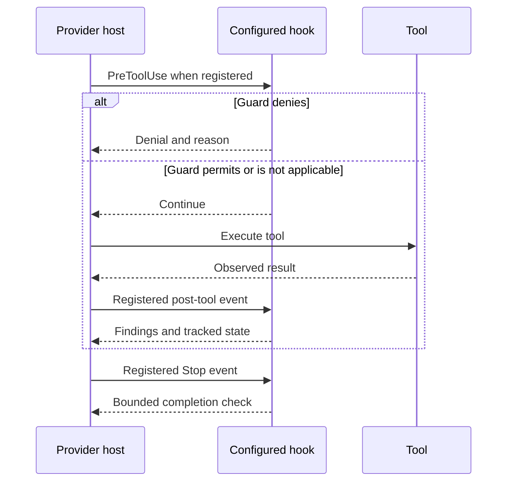

# Tool hooks, runtime controls and release gates

Owner: JAI maintainers · Last reviewed: 2026-10-20

This page describes JAI 26.10.12 source and packaged provider snippets.
It does not certify that a particular host installed or activated them.
Status labels follow the [execution
overview](../overview/execution-context-algorithm.md#reading-implementation-status).

## Separate the control boundaries

| Mechanism | Activation | What it establishes |
| --- | --- | --- |
| Role/workflow routing | Supported skill/command and actual agent actions | A procedural specialist/workflow choice; no universal message interceptor. |
| Reference/DCS resolution | Explicit local runtime calls | Registered obligations and selected illustrative file; no automatic prompt loading. |
| Provider hook | Configured provider tool/lifecycle event | Local allow/deny or observed state within that hook's coverage. |
| Domain validation | A semantic model and applicable checker | Rule/evidence findings for that artifact and snapshot. |
| A–H qualification | Explicit full preflight or release workflow | Executed product-release checks; no project L0 approval. |

In particular, the interactive `code_gate.py` hook is not GitHub Gate A.
Neither one selects expert reference sections or grants human authority.

## Packaged hooks and provider events

**IMPLEMENTED:** sources are in `.ai/runtime/hooks/`; registrations are
`.ai/adapters/claude/settings.snippet.json` and
`.ai/adapters/codex/hooks.snippet.json`. `.ai/setup/installer.py`
renders placeholders and merges the snippets into the provider
configuration. Codex's snippet explicitly requests review of changed
hooks after installation/update.

| Hook | Claude registration | Codex registration |
| --- | --- | --- |
| `guard_library_write.py` | `PreToolUse`: `Write`, `Edit`, `MultiEdit`, `NotebookEdit` | `PreToolUse`: `Write`, `Edit`, `apply_patch` |
| `guard_authority.py` | `PreToolUse`: `Bash`, `PowerShell`, `Read`, `Write`, `Edit`, `MultiEdit`, `NotebookEdit` | `PreToolUse`: `Bash`, `Read`, `Write`, `Edit`, `apply_patch` |
| `code_gate.py` | `PostToolUse`: `Write`, `Edit`, `MultiEdit`, `Bash`, `PowerShell`; `PostToolUseFailure`: `Bash`, `PowerShell`; `Stop`, `SubagentStop` | `PostToolUse`: `Write`, `Edit`, `apply_patch`, `Bash`; `Stop`, `SubagentStop` |

These are the literal shipped matchers. Handler support for an
additional tool name does not prove the provider registration matches
that event. **NOT VERIFIED:** event delivery, tool aliases and active
installation in a specific session without inspecting that host's
configuration/events.

### Library writes

`guard_library_write.py` checks recognized target paths against
protected live library files/skill directories and a current
scope-covering approval record. Staging is a separate path. It parses
Codex patch target lines as well as named write/edit targets; a refused
write reports a blocking exit.

Its `targets()` and `approval_covers()` logic is not a filesystem
sandbox or a comprehensive shell mutation monitor.
Unrecognized/malformed payloads can have no detected target; provider
event coverage and host permissions remain material. It does not decide
professional content correctness.

### Human authority and records

`guard_authority.py` uses string/path matching for authority-sensitive
operations, protected records and authority-key custody. Claude can
receive an `ask` decision for supported interactive authority actions;
listed noninteractive permission modes deny them. `decide()` converts
`ask` to `deny` for Codex. The human must perform the authority act
through the separately authorized process; the agent cannot manufacture
that approval.

The source explicitly limits this to a string-level guard. It can miss
unrecognized actions or reject text that happens to match a protected
pattern. It does not replace authenticated principals, sandboxing,
credential custody or append-only storage protections. See [human
authority](../operations/human-authority.md).

### Interactive code/documentation checks

`code_gate.py:on_write()` invokes documentation/testing checks for
observed edits and records outstanding issues. `on_command()` recognizes
supported test-command patterns and observed failures. `on_stop()`
checks remaining issues and whether tests ran after the tracked
production change.

This is bounded session bookkeeping, not an unconditional completion
lock. The source supports project opt-out markers `.ai/no-doc-check` and
`.ai/no-test-check` (plus provider-specific equivalents). A repeated
stop or `stop_hook_active` permits completion while reporting remaining
issues. Post-tool checks run after the write; they do not undo it. A
recognized successful test command is not proof of exhaustive project
coverage.

The diagram assumes installed, supported events. It is not a live trace.

## Gate A in the current release code

**IMPLEMENTED:** `.ai/runtime/tools/qualification_core.py` defines
`REGRESSION_MODULES` (22 modules), `regression_checks()` and `gate_a()`.
Modules run sequentially in separate offline-controlled processes, not
as 22 parallel GitHub jobs. Each uses `python -u -m pytest -vv -s` with
a 600-second bound. The inventory includes content, reference, workflow,
publication, evaluation, offline-control and release regression modules.

Gate A also executes four generated-data reproducibility checks, the
full-source synthetic pilot, reference integrity, lifecycle scenarios,
extended payload integrity, proposal consistency, schema/artifact
checks, documentation and structural policy checks.
`release_ga.py:gate_a()` adds release/version/changelog policy, giving
44 checks in the inspected code.

`command()` records elapsed time and each limit. `offline_guard.py`
applies inherited Linux network denial, terminates the process group on
timeout and retains captured output. Timeout is `FAIL`, not a benign
skip. Explicit `--stream` displays progress; it does not make checks
faster or change the default captured API. The complete regression
budget is 13,320 seconds; the A–H outer budget is 19,560 seconds. Both
are ceilings, not measured or promised durations.

The optimized source workflow runs bounded smoke/structural checks on
ordinary push/PR. Its manual full-qualification option and the tagged
release run A–H once plus test modules outside Gate A's inventory;
`scripts/ci_test_plan.py` partitions those modules without overlap. See
[offline qualification](../validation/offline-content-qualification.md)
for current commands and [release controls](../operations/validation.md)
for the evidence boundary. This page does not assert that a timeout was
resolved on a GitHub runner or that the current source passed release
CI.

An individual module's successful process exit does not assert that every
collected pytest case executed. Inspect skipped-case counts and their
reasons; the gate wrapper does not independently reject every pytest skip.

## Aggregation, evidence and limitations

**IMPLEMENTED:** `gate_payload()` requires a nonempty set of executed
checks with `ok is True` and `state == PASS`. `gate_report_problems()`
rejects mismatched gate/release identity, missing checks and
contradictory results. `release_ga.py:assemble()` requires A through G;
H generates and verifies supply-chain material and final policy. CI
additionally validates the release tag and its main-branch ancestry.

**NOT IMPLEMENTED in the gate-report validator:** reconstructing the
exact expected module/check inventory from an arbitrary supplied report,
rejecting duplicate check names, or binding each gate report to a commit
digest. Release-version equality alone is not commit identity. Normal
execution constructs the full check list in code, and regression tests
check that inventory; this is different from validating an independently
supplied partial or same-version stale report. Supply-chain provenance
is a separate verification layer, not permission to infer these missing
report checks.

**PROPOSED:** strengthen report inventory, uniqueness and
source-snapshot binding if independently supplied reports need those
guarantees. This documents a follow-up gap without changing gates or
release policy here.

**NOT VERIFIED:** current remote CI success, universal provider hook
coverage, or live model quality from source inspection alone. Existing
historical evidence applies only to its actual qualified snapshot. No
A–H or live-provider execution is implied by a documentation build.

## Domain and publication controls remain separate

`content_lint.py:evaluate()` validates semantic fields, applicability,
evidence and review conditions. `projection.py:build()` produces
controlled publication data; `publication.py:render_verified()` checks
immutable QA sidecars and matching manifest/content before rendering a
marked draft. The current content-aware path uses a v4 projection
manifest; earlier v3 lineage terminology does not waive its newer
content checks. `visual_qa.py` examines actual rendered output, not an
imagined layout. Missing required renderers cannot establish a passing
render gate.

These controls do not make synthetic facts true, supply independent
human review or grant L0 acceptance. See
[DCS](../capabilities/document-content-specifications.md),
[reference/context
delivery](../reference/reference-selection-context.md) and
[publication](../capabilities/artifacts-publication.md).
