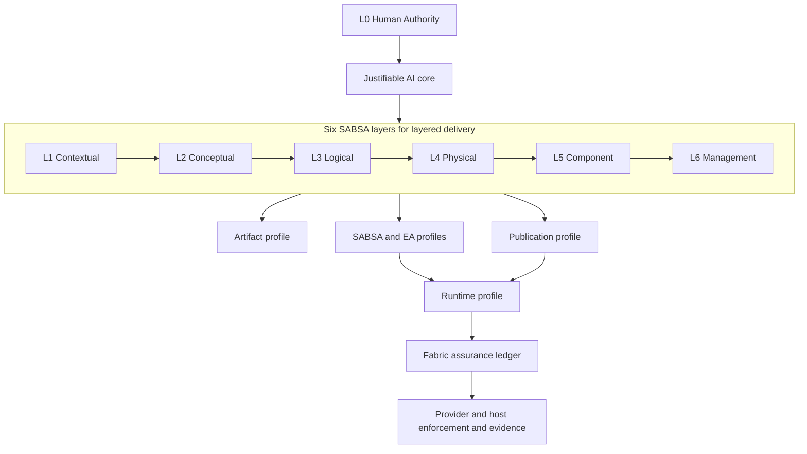
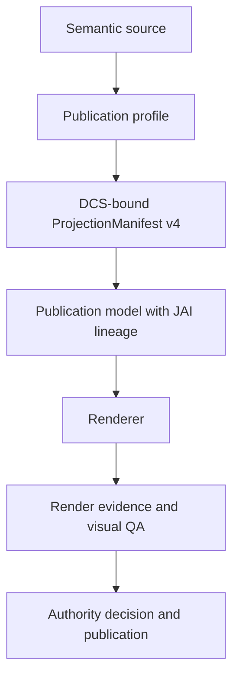
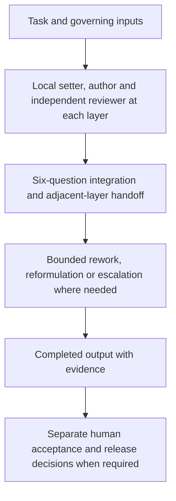

# System architecture

AI IT House {{ JAI_VERSION }} separates **normative semantic architecture**, **domain profiles**, **runtime enforcement** and **provider-specific rendering**.

The architecture chapters follow three lines of inquiry.

1. [Execution and context assembly](../overview/execution-context-algorithm.md)
   follows a request into the role catalogue, selected instructions and the
   active provider. [Hierarchical role discovery](../architecture/hierarchical-role-discovery.md)
   explains how the catalogue scales.
2. The [delivery model](../overview/delivery-model.md) introduces the flow of
   professional work. The [SABSA layer model](../architecture/sabsa-layer-model.md)
   and [layer-local workflow](../architecture/governed-layer-workflow.md)
   explain how responsibilities, review and handoffs fit together.
3. [Versioned inputs and applicability](../architecture/governed-runtime-cutover.md)
   explains what happens as inputs change. The [dispatch boundary](../architecture/governed-dispatch-boundary.md)
   describes how the runtime enforces the assignment's authority and effects.

For choosing how much assurance a specific task needs, see
[Methodical workflows](../using/methodical-workflows.md).

## JAI as the normative top-level architecture

The layered delivery mode uses a six-layer SABSA matrix. Ad-hoc specialist work
and selected workflows reuse the same catalogue without requiring the whole
matrix. Human Authority is the external L0 boundary in every mode.

Artifact, SABSA, EA, Publication and Runtime are profiles or enforcement mechanisms of that core. They do not become parallel global sources of truth.

## Scoped authority

Examples:

- JAI owns canonical semantic identity;
- SABSA owns its methodology coordinates/semantics within the SABSA profile;
- the EA repository is authoritative for the **EA-domain projection**;
- ProjectionManifest is authoritative for the audience-specific publication projection it describes;
- ExecutionRecord is evidence of what the runtime recorded, not proof that an external system behaved correctly beyond that evidence.

This scope discipline prevents the phrase “source of truth” from being used without saying **for what**.

## Provider-neutral package structure

- `.ai/runtime/` — provider-neutral JAI core, roles, workflows, schemas, publication, policies, EA/SABSA tooling and Fabric runtime;
- `.ai/agents/` — canonical agent definitions and authority/tool boundaries;
- `.ai/skills/` — knowledge and procedure skills;
- `.ai/commands/` — user-facing workflow commands;
- `.ai/adapters/` — provider-specific rendering/compatibility logic;
- `.ai/setup/` — installation/uninstallation implementation.

## Common runtime services

The common runtime includes:

- JAI core registries and profiles;
- role/workflow catalogue;
- Artifact Contract v3 registry;
- provider-neutral model/workload routing;
- SABSA semantic tooling;
- scoped EA repository and ArchiMate/Open Exchange tooling;
- publication projection, rendering and visual QA;
- policy/agent enforcement and content-hashed Execution Records (not immutable custody);
- output validation and tag-driven product release checks;
- Justifiable Fabric supervision runtime.

## Skills versus agents

A useful mental model is:

- **skill** = knowledge, method or procedure;
- **agent** = execution/authority boundary with tools and workload class.

Governance therefore does not depend on a “personality prompt” alone. Reviews, writes, execution and authority can be separated by tool capabilities and runtime policy.

## Fabric relationship to the semantic model

The governed runtime records immutable versions, dependencies, decisions and
scoped applicability. Product and evidence records carry exact references and
content identities so audit can explain the basis of a particular output. The
ledger does not make unrelated historical conclusions current.

## Publication path

The production publication sequence is:

A production render that bypasses the matching ProjectionManifest is not the supported current write path.

## Layered engagement path

The `/layered` path adds the supervised JAI execution cycle around consequential work:

See [Layered runtime and assurance model](../capabilities/layered-runtime.md) for detailed enforcement semantics.

## Implementation details

[Execution and context assembly](../overview/execution-context-algorithm.md) describes context assembly and runtime boundaries.
See how the architecture maps to supported procedures and actual runtime calls.
