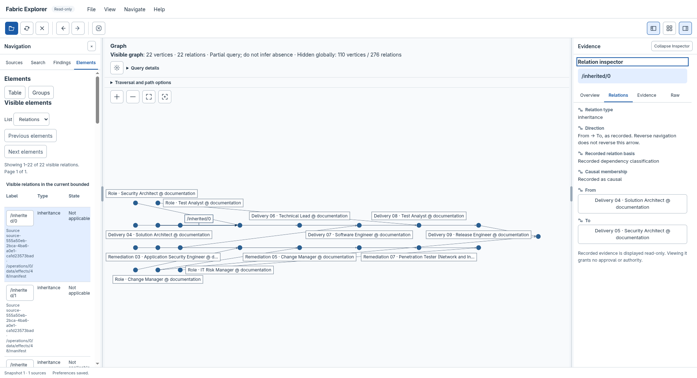
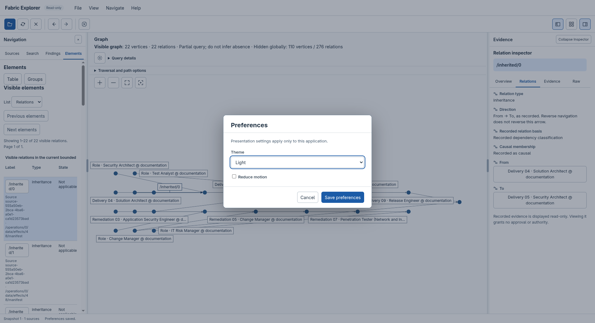

# Explore data

The viewer reads local sources without changing them. A successful selection
starts loading automatically; there is no separate normal Import step.

Before opening a project, [check that it has recorded source journals](importing.md#before-you-open-a-project-are-there-records-to-display).
Ordinary use of JAI does not guarantee `.fabric/` exists. If the project has only
`.findings/`, select **Findings** and deselect **Fabric**; if neither family has
records, the viewer has no recorded graph to import. Fabric journals may also
be stored outside the project.

## Open a project

1. Use the **Sources** tab to choose the source families. Fabric and Findings
   are the usual selection; Audit uses explicit file selection.
2. Choose **File → Open sources…** or the matching toolbar icon, then select
   the project directory.
3. Wait for the snapshot and graph to become available. Progress reports the
   current stage and available byte, record, projected-fact and source counts.

For Fabric and Findings, immediate regular `.jsonl` files in the project's
`.fabric/` and `.findings/` directories are selected automatically. If automatic
lookup cannot select a family, a native file dialog lets you choose its files.
The lookup does not execute project configuration or code.

!!! tip "Entering a path in a GNOME folder dialog"
    Press `Ctrl+L`, enter the full directory path and press **Enter** to navigate
    into it. Verify the current folder, then choose **Select**. Merely typing a
    path does not necessarily change the folder that Select will return.

Cancel the selection dialog to stop before loading. During loading, **Cancel
operation** stops the active work. A failed or cancelled load can offer **Retry
import** for an admitted selection without a snapshot; **Close sources** lets
you choose again. Inspect source compatibility and diagnostics when a file or
version cannot be read.

## Find an entity or a finding

Use **Search** for a label or complete stable identity. Submit the search, then
select the matching result. Use **Findings** for its separate searchable list;
finding IDs are local to their ledger, so the same ID in another ledger is a
different record. Page controls replace the bounded result page rather than
accumulating the entire dataset.

**Filters** in Search or Findings exposes the retained project, family, finding
state and relation filters. Filters affect the indexed results and visible
graph consistently. Reset them to restore the retained neighbourhood without
another import.

The **Elements** tab provides a semantic table of the current projection and
derived overview groups. Vertex and relation modes keep parallel edges
individually addressable. These controls also provide a non-spatial route to
selection.

## Explore the graph

Selecting a result, table row or graph item changes the inspector. It does not
automatically replace the graph with every related record.

To inspect a selected vertex's neighbourhood, choose **Navigate → Explore
selected neighbourhood** or its graph command icon. Use **Fit graph** to bring
the resulting view into frame. Wheel to zoom and drag the background to pan;
the named zoom, fit and focus commands are also available through the controls
and View menu.

**Traversal and path options** exposes direction, hop bounds, causal selection
and path commands. Choose a path start, select a destination and request a path.
Original arrow direction is retained even when navigating in reverse. An
incomplete bounded search cannot establish that a path or relationship is
absent.

Read **Visible graph**, **Hidden globally** and **Query details** together. The
current graph is a bounded neighbourhood or path, while snapshot totals and
filter matches describe different scopes. An initial graph with few vertices
does not mean that only those records were imported.

## Inspect identity and evidence

The inspector has four discoverable tabs:

| Tab | Contents |
| --- | --- |
| Overview | The selected record's identifying fields, kind and finding state where applicable. |
| Relations | Recorded direction, endpoints, relationship basis and finding subjects. |
| Evidence | Source provenance and bounded captured-source pages. |
| Raw | Complete stable identity, original fields and tagged attributes. |

Follow an endpoint or finding subject to inspect that exact record. Unresolved
or textual locations remain explicit; the viewer does not invent a semantic
match. A relationship's direction and basis must be read from its recorded
evidence, not inferred from its visual position.

### Inspect a recorded relationship

*Selecting a relation exposes its recorded type, direction, basis and endpoints.
Here the endpoints are public workflow-stage definitions; the dependency does
not claim that either stage was executed. Select the image for the full-size
view of the graph and inspector.*

**Read captured source** displays bytes from the captured revision. Previous and
next pages count bytes; a UTF-8 page boundary can display a replacement
character without changing the captured bytes. HTML-like titles and payloads
remain literal text and are never executed as page content.

## Arrange the workspace

Drag either separator beside the graph to resize its neighbouring pane. A
focused separator accepts Left/Right arrows, Shift+Arrow for a larger step,
Home/End for its bounds and Enter to reset. Double-click also resets it.
**View → Reset pane widths** restores both session defaults. Width changes do
not change the graph selection or query scope.

Navigation and inspector tabs expose their sections without scrolling through
unrelated panels. In a narrow window, use the Navigation and Inspector toolbar
icons or View commands to open the relevant drawer. Toolbar tooltips show full
command names; menus provide their labelled equivalents.

**File → Preferences…** opens a separate dialog. Change Theme or Reduce motion,
then choose **Save preferences**. **Cancel** or Escape discards an unsubmitted
draft. A failed save leaves the draft available; dismissal is temporarily
disabled while a submitted save completes.

*Preferences opens in a separate dialog while the current graph remains in the
background. Save preferences applies the draft; Cancel discards it. Select the
image to view the controls at full size.*

## Refresh and return

Use **Refresh snapshot** for later source changes. An unsuccessful refresh
retains the accepted snapshot with an explicit stale warning. Close and reopen
sources when their admitted file identities have been replaced.

Back and Forward restore bounded navigation intents within the current
generation. A successful changed-source refresh publishes a new generation and
invalidates its previous source pages and history. Closing sources releases the
current source view; restarting after a crash does not reopen a project
automatically.

| Shortcut | Action |
| --- | --- |
| `Ctrl/Cmd+K` outside editable controls | Focus Search. |
| `Ctrl/Cmd+Shift+F` outside editable controls | Fit graph. |
| `Ctrl/Cmd+,` outside editable controls | Open Preferences. |
| `Alt+Left` / `Alt+Right` outside editable controls | Back / Forward. |
| Arrow keys and Home/End on tabs | Select and focus a section. |
| Escape | Dismiss the active tooltip, menu or dialog first; otherwise cancel active work outside editable controls. |

Use **Help → Help and keyboard bindings** for the available controls. Viewing
recorded data grants no approval, authority or release permission.
