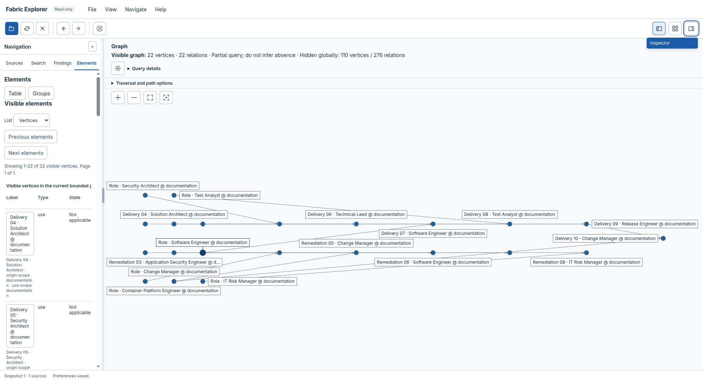

# Fabric Explorer

Fabric Explorer is an optional desktop application for exploring JAI Fabric,
findings and their recorded relationships. It opens local data read-only and
runs offline. Use it to find an exact entity, inspect a relationship's direction
and evidence, or follow a finding to its recorded subject.

!!! important "The viewer needs existing recorded data"
    Using JAI does not automatically create a project `.fabric/`. Fabric records
    arise from an actual layered engagement or another operation that writes to
    the Fabric runtime. Reviews can separately create `.findings/`, which the
    viewer can open on its own. Before opening a project, check
    [when there is data to display and where to find it](importing.md#before-you-open-a-project-are-there-records-to-display).

- [Install and update](installation.md) explains the separate viewer package,
  launcher, upgrade, rollback and removal.
- [Explore data](exploring.md) covers opening a project, searching, navigating
  the graph, reading evidence and changing the workspace.

## Manual and technical reference

| Topic | Chapters |
| --- | --- |
| Work with local data | [Import and refresh](importing.md), [semantic tables](semantic-tables.md), [exploration reference](exploration-reference.md) |
| Read and arrange the graph | [Canvas](canvas.md), [layouts](layouts.md), [indexed queries](graph-queries.md) |
| Understand the implementation | [Architecture](architecture.md), [design decisions](decisions.md), [desktop shell](desktop-shell.md) |
| Integrate consumers | [Source formats](source-contract.md), [consumer model](contracts.md), [query transport](query-transport.md), [presentation contracts](presentation-contracts.md) |
| Build and operate | [Package building](building-packages.md), [package integrity and recovery](package-installation.md), [support](support.md), [qualification](qualification.md), [security boundaries](security-qualification.md) |

## Separate from the JAI installer

The main JAI repository contains the viewer's maintained source and
documentation. The normal `./install.sh` installs the JAI tools; it does not
build or install Fabric Explorer.

The viewer is distributed separately as a platform-specific archive with its
native runtime and a per-user installer. End users of that package do not need
Python, Node.js, npm or a compiler. Building the viewer from source is a separate,
explicit developer operation and requires its development toolchain; it is not
an implicit step of the main JAI installation.

## What the viewer shows

The workspace has Sources, Search, Findings and Elements navigation tabs, a
central graph and a tabbed inspector. Toolbar icons have named menu equivalents.
The graph's neighbouring panels can be resized without changing the selected
data. Preferences opens in its own dialog.

A graph view is a bounded neighbourhood or path, not necessarily the complete
snapshot. Visible and globally hidden counts explain its scope. Exact identities,
parallel relations and unresolved references remain distinct; a readable label
does not replace the original identity.

The viewer displays recorded evidence. Connectivity does not establish current
permission, approval, correctness or causality. Source text, including HTML-like
labels, remains inert text. The application does not repair journals or execute
project code.

A source-derived view can also explain JAI's workflow architecture. The public
reference example maps Idea to production and Vulnerability to remediation.
Its `Role · Software Engineer` record connects the quoted role references in
both workflows. Explore that neighbourhood to inspect the branching source
relationships. These links represent published stage ordering and role
references, not observed workflow execution or approval.

*The public reference example links workflow-stage definitions and role
references. This bounded view contains 22 vertices and 22 relations; its partial
status and globally hidden counts remain visible. It does not represent
executed workflows or approvals. Select the image to inspect it at full size.*

## Validation boundary

Installed unsigned Linux x64 development packages have completed owner-observed
functional and ergonomic checks. These observations do not establish a signed
production release, clean-machine or minimum-OS support, or native qualification
of every packaging target. Obtain a package with an explicit validation and
signing status; do not infer support from an archive's existence alone.
