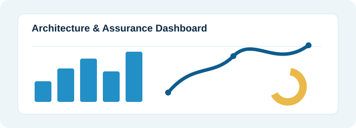

---
hide:
  - navigation
  - toc
hide_header: true
hide_footer: true
title: AI IT House Universal
---

  <aside class="ai-home-sidebar-v31" aria-label="Documentation navigation">
    <a class="ai-sidebar-brand-v31" href="./">
      
      <strong>AI IT HOUSE</strong><em>UNIVERSAL</em>
    </a>
    <nav class="ai-sidebar-nav-v31" aria-label="Documentation sections">
      <!-- JAI_CANONICAL_NAVIGATION -->
    </nav>
    

      
From Understanding to Justifiable Decisions.

      <a href="https://doi.org/10.13140/RG.2.2.29244.19843" target="_blank" rel="noopener">▱ &nbsp; Read the Article</a>
      <small>Unified Lifecycle GA</small>
    

  </aside>

  <main class="ai-home-main-v31">
    <section class="ai-home-hero-v31">
      
      

      

        
ARCHITECTURE · SECURITY · GOVERNANCE · DELIVERED

        
A JUSTIFIABLE AI FABRIC FOR ENTERPRISE IS/IT AND SECURITY

        <h1>Turn complexity into justifiable progress.</h1>
        
AI IT House Universal helps enterprise teams design, analyse and document IS/IT and security solutions with traceable reasoning, structured knowledge and professional deliverables — aligned with SABSA and leading practices.

        

          <a class="ai-btn-v31 ai-primary-v31" href="getting-started/quick-start/">Get Started →</a>
          <a class="ai-btn-v31 ai-download-v31" href="https://github.com/__JAI_GITHUB_REPOSITORY__/releases" target="_blank" rel="noopener noreferrer" aria-label="Download a published JAI release from GitHub">↓ Download JAI</a>
          <a class="ai-btn-v31 ai-github-v31" href="https://github.com/__JAI_GITHUB_REPOSITORY__" target="_blank" rel="noopener noreferrer" aria-label="View the JAI source repository on GitHub">↗ View on GitHub</a>
        

        
▱
Built on the principles of Justifiable AI <a href="https://doi.org/10.13140/RG.2.2.29244.19843" target="_blank" rel="noopener">https://doi.org/10.13140/RG.2.2.29244.19843 ↗</a>

      

    </section>

    <section class="ai-home-learning" aria-labelledby="ai-home-learning-title">
      <h2 id="ai-home-learning-title">Find your way through JAI</h2>
      

        <a href="using/methodical-workflows/">Choose your workflow →</a>
        <a href="examples/how-to-use-JAI/">Follow the worked guides →</a>
        <a href="using/commands/">Look up commands →</a>
        <a href="overview/product-overview/">Explore the product overview →</a>
      

    </section>

    <section class="ai-feature-band-v31">

      
<svg viewBox="0 0 48 48"><circle cx="24" cy="24" r="16"/><path d="M17 31 23 18l8-4-4 9z"/></svg><strong>Enterprise Scope</strong>Architecture, security, risk, governance and delivery

      
<svg viewBox="0 0 48 48"><circle cx="18" cy="19" r="6"/><circle cx="31" cy="20" r="5"/><path d="M7 37c1-8 6-12 11-12s10 4 11 12M27 29c7 0 11 3 13 9"/></svg><strong>Broad Role Coverage</strong>{{ JAI_ROLE_COVERAGE }}

      
<svg viewBox="0 0 48 48"><path d="M13 7h17l7 7v27H13z"/><path d="M30 7v8h8M18 22h14M18 28h14M18 34h10"/></svg><strong>Professional Deliverables</strong>Documents, models, diagrams and reports

      
<svg viewBox="0 0 48 48"><circle cx="13" cy="16" r="4"/><circle cx="34" cy="12" r="4"/><circle cx="35" cy="34" r="4"/><circle cx="13" cy="34" r="4"/><path d="M17 16l13-3M16 19l16 12M17 34h14M34 16v14"/></svg><strong>Structured Knowledge</strong>SABSA-aligned and traceable

      
<svg viewBox="0 0 48 48"><circle cx="24" cy="24" r="7"/><path d="M24 6v6M24 36v6M6 24h6M36 24h6M11 11l4 4M33 33l4 4M37 11l-4 4M15 33l-4 4"/></svg><strong>Practical by Design</strong>From analysis to implementation support

      
<svg viewBox="0 0 48 48"><path d="M24 5 38 11v10c0 10-6 17-14 22-8-5-14-12-14-22V11z"/><path d="m17 24 5 5 10-12"/></svg><strong>Responsible AI</strong>Justifiable, auditable and human-led

    
</section>

    <section class="ai-achieve-v31">

      <h2>What You Can Achieve</h2>
      
AI IT House Universal supports a broad end-to-end IS/IT and security lifecycle — from business drivers to operational assurance — with governed, traceable outputs.

      

        <a class="ai-achieve-card-v31" href="capabilities/sabsa-ea/">
<strong>Design with Confidence</strong>Create business-aligned architectures and security solutions using structured methods and AI support.
</a>
        <a class="ai-achieve-card-v31" href="capabilities/justifiable-fabric/">
<strong>Reduce Risk, Increase Clarity</strong>Analyse threats, controls and trade-offs with traceable reasoning.
</a>
        <a class="ai-achieve-card-v31" href="capabilities/artifacts-publication/">
<strong>Produce Professional Outputs</strong>Generate high-quality documents, diagrams and models ready for stakeholders.
</a>
        <a class="ai-achieve-card-v31" href="using/workflows/">
<strong>Enable Collaboration</strong>Support multiple roles, viewpoints and governance processes across your organisation.
</a>
      

      

        
<strong>Typical Workflow</strong>From business drivers to approved and published deliverables.

        

          <b>Business Driver</b><i>→</i><b>Analyse &amp; Model</b><i>→</i><b>Generate Deliverables</b><i>→</i><b>Review &amp; Validate</b><i>→</i><b>Approve</b><i>→</i><b>Publish &amp; Use</b>
        

        <a href="using/workflows/">Explore all workflows →</a>
      

    
</section>

    
<footer class="ai-home-footer-v31">Copyright © 2026 Leo Galambos and Egothor Project TeamAI IT House Universal · Documentation</footer>

  </main>

