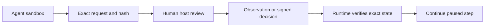

# Exact operator actions in 26.10.14

Owner: JAI maintainers. Scope: {{ JAI_SCOPE }}. The prompts, host commands and
developer diagnostics below are separate surfaces. Work in a disposable project;
replace JAI_RUNTIME with the reviewed installed runtime, normally
`$HOME/.ai/it-role-house`. Never return a private key or provider credentials.



| Component | Responsibility | Assurance limit |
| --- | --- | --- |
| JAI | Contract checks, protected-path hooks, signed exact-state L0 verification | Not universal OS isolation |
| Native provider | Effective sandbox and tool permissions | Prompts and projections are not independent host certification |
| Administrator | Protect public pin, private key, trusted helper and containment | Must remain outside agent-writable scope |
| Operator | Independently inspect and execute the exact action | Same UID or a keypress alone is not identity proof |
| Release owner | Git review, merge, tag, signing and publication | A render or Fabric receipt grants none of these |

## Routine execution first; self-contained human requests

A / AUTO is ordinary authorized work within the real native sandbox. B is an
observed native permission request. C is independent operator execution, not L0.
D is a formal consequential decision. A/B/C are execution routes; D is authority,
so D may precede C without turning every C action into a human decision.

Agents must run role-permitted pytest/build/WeasyPrint locally when possible.
Do not ask a human merely because a shell tool is involved. Reviewers never
write reviewed source: disable source caches or use explicitly native-writable
QA scratch. If the real read-only boundary cannot support the required output,
record the limitation and use an independent C action; never expand permissions.

Every B/C/D conversation request MUST give the category and FORMAL L0 YES/NO,
objective, exact observed reason (or honest policy/prerequisite), attempts and
alternatives, full command/workdir/input/output/privileges, sensitive/external
access, effects/reversibility and verification/resume steps inline. A request
file is secondary. If the reviewed signer/key location is only known on the
host, say COMMAND NOT READY and what the host operator must select; never ask
for private keys in chat or accept a chat approval as a credential.

### Local Chromium example — A when executable, otherwise observed C

For an execute-tier author in an authorized project, prepare approved static
HTML with no scripts/external URLs under build/local-qa. Use a disposable profile,
never a personal browser profile or a protected directory. Run inside the current
sandbox first (normal QA, no L0):

```sh
mkdir -p build/local-qa
printf '%s\n' '<!doctype html><html lang="en"><meta charset="utf-8"><title>Local QA</title><h1>Approved static QA page</h1></html>' > build/local-qa/page.html
chromium-browser --headless --disable-gpu --disable-background-networking --disable-extensions --no-first-run --hide-scrollbars --user-data-dir="$PWD/build/local-qa/profile" --screenshot="$PWD/build/local-qa/page.png" --window-size=1200,800 "file://$PWD/build/local-qa/page.html"
```

These flags do not grant OS containment or a network firewall. The actual native
filesystem/network restrictions remain decisive. Do not use sandbox-disabling,
web-security-disabling or unrestricted file-access flags. Untrusted HTML/JS is
not an approved local QA input and needs separate containment/review. Missing
Chromium is optional dependency absence, not L0.

If the actual error is socket() failed: Operation not permitted, the agent can
request C with the exact failing command adjusted only to an approved fresh host
profile/output. State that error, input hash, workdir and complete invocation
inline; say FORMAL L0: NO. Do not make the human find a command in this guide.
The operator returns exit status and PNG; JAI checks unchanged input, real image
and dimensions. This is an observation, not cryptographic execution attestation.
WeasyPrint can be a document-PDF alternative but does not prove Chromium layout.

## Conversation prompt

In Codex or Claude: “Prepare the exact request with IDs, input/state hashes,
policy, expiry, proposed effects and output paths; wait for returned evidence.”
This prompt is not authorization. Both providers remain in their native sandbox.

## Fabric: external operator L0

Use a synthetic engagement from the layered workflow; obtain actual engagement,
fragment and escalation IDs from status/report. Do not invent IDs. Diagnostic:

```sh
JAI_RUNTIME="$HOME/.ai/it-role-house"
python3 "$JAI_RUNTIME/fabric/fabric.py" status DEMO_ENGAGEMENT
python3 "$JAI_RUNTIME/fabric/fabric.py" report DEMO_ENGAGEMENT
```

Replace DEMO_ENGAGEMENT and FRAGMENT_ID with reported IDs of an L1 fragment.
The following command plans a request; it does not commit human authority.

```sh
python3 "$JAI_RUNTIME/fabric/fabric.py" review DEMO_ENGAGEMENT FRAGMENT_ID --layer 0 --state accepts --rationale "Synthetic owner review" --reviewer "Demo operator" --model human --request-out review-request.json
```

Expected result: OPERATOR_ACTION_REQUIRED, with an exact request JSON. Inspect
request_id, all planned entries/object IDs, snapshot/hash, policy digest/version,
rationale, consequences and expiry. No L0 entry is committed by planning.

### Enrollment and signing: host operator only

**Fresh-host setup recipe: NOT_VERIFIED.** These commands are provided for
administrator review, not unattended setup. Existing reference enrollment and
signed decisions have been exercised separately; they do not establish this
recipe's execution or isolation on a new host. Verify the target before use.

The installer creates no key. Generate a NEW Ed25519 key outside agent mounts,
export only its public PEM and have the administrator enroll a root-owned,
non-group/world-writable public pin at `~/.ai/jai-operator-trust.json`.
Its JSON fields are schema_version=1, policy_version=local-operator-attestation/1,
public_key (exact PEM) and key_id (SHA-256 of those PEM bytes). Protect directory
containment too. Existing enrollment must not be overwritten for an example.
Private-key/trust separation must be independently established, not inferred
from a path, same UID, environment flag or conversation. Otherwise L0 is UNAVAILABLE.

For NEW enrollment only, set HOST_KEY_DIRECTORY in the host console to a
new directory outside every agent-readable/writable mount. Do not use the
project directory. These operator-only commands create persistent key material;
review them and never overwrite an existing enrollment:

```sh
umask 077
mkdir -m 700 "$HOST_KEY_DIRECTORY"
openssl genpkey -algorithm ED25519 -out "$HOST_KEY_DIRECTORY/private.pem"
openssl pkey -in "$HOST_KEY_DIRECTORY/private.pem" -pubout -out "$HOST_KEY_DIRECTORY/public.pem"
python3 - "$HOST_KEY_DIRECTORY" <<'PY'
import hashlib, json, pathlib, sys
directory = pathlib.Path(sys.argv[1])
public = (directory / 'public.pem').read_text()
pin = {'schema_version': 1, 'policy_version': 'local-operator-attestation/1',
       'key_id': hashlib.sha256(public.encode()).hexdigest(), 'public_key': public}
(directory / 'trust.json').write_text(json.dumps(pin, indent=2) + '\n')
PY
test ! -e "$HOME/.ai/jai-operator-trust.json"
```

The final test must succeed before administrator enrollment. The administrator
reviews the public JSON, then explicitly runs this ONE public-pin install:

```sh
sudo install -o root -g root -m 0644 "$HOST_KEY_DIRECTORY/trust.json" "$HOME/.ai/jai-operator-trust.json"
```

This is a persistent trust change, not permission for agent enrollment. If an
existing pin is present, stop and use an independently reviewed rotation plan.
Return only public key ID/tool version and public ownership metadata. Removing
a newly unused key/pin is an operator decision; never delete established keys
as an automatic rollback. No agent performs enrollment.

Review SHA-256 of installed operator_actions.py, office_renderer.py and
visual_qa.py, then copy them to a host-only reviewed helper directory. In the
HOST terminal set REVIEWED_HELPER to that directory and OPERATOR_KEY to the
external private key; neither is an agent-provided privilege grant.

After choosing a NEW host-only REVIEWED_HELPER directory, the operator runs:

```sh
mkdir -m 700 "$REVIEWED_HELPER"
for module in operator_actions office_renderer visual_qa; do
  sha256sum "$JAI_RUNTIME/tools/$module.py"
  cp -- "$JAI_RUNTIME/tools/$module.py" "$REVIEWED_HELPER/$module.py"
  sha256sum "$REVIEWED_HELPER/$module.py"
done
```

Compare each pair with the reviewed release's source inventory before signing.
The copy has no key and must not remain writable by model-controlled tools.

```sh
python3 -I -c 'import sys;sys.path.insert(0,sys.argv.pop(1));import operator_actions;sys.exit(operator_actions.main())' "$REVIEWED_HELPER" sign "$PWD/review-request.json" --workspace "$PWD" --key "$OPERATOR_KEY"
```

Read the preview; type APPROVE followed by the displayed UUID, or DENY followed
by that UUID. Return only the public receipt path/hash. The receipt is written
beside the request under receipts/UUID.json. Runtime continuation:

```sh
python3 "$JAI_RUNTIME/fabric/fabric.py" apply-operator review-request.json receipts/UUID.json
python3 "$JAI_RUNTIME/fabric/fabric.py" verify DEMO_ENGAGEMENT
python3 "$JAI_RUNTIME/fabric/fabric.py" justify DEMO_ENGAGEMENT FRAGMENT_ID --strict --json
```

Substitute actual UUID/IDs. Declining leaves the ledger unchanged; signing a
domain REJECT instead authorizes recording a rejection. Tamper, expiry, stale
snapshot/policy and replay deny; request again rather than editing signed data.
Strict justification may still fail for incomplete lower-layer evidence.
Assurance: LOCAL_OPERATOR_ATTESTATION, not enterprise IAM or nonrepudiation.
Local hash-chained records are not rollback-resistant/immutable custody.

## Render actual files

For optional HTML/PDF, use the [clean renderer environment](../getting-started/install.md#a-clean-optional-renderer-environment)
with WeasyPrint 70 and Pyphen 0.17.x. Use its Python for `html-auto` requests;
the source format alone does not choose your interpreter or venv.

Portable requirements: renderer libraries/fonts, Poppler pdftoppm, and an actual
Office renderer for Office files. Fedora host package proposal (operator only):

```sh
sudo dnf install libreoffice poppler-utils openssl dejavu-sans-fonts
```

This changes host packages, not Fabric authority. Use normal-user rendering;
untrusted Office files require suitable host containment and no unnecessary
elevation. Do not broaden provider network/sandbox permissions for LibreOffice.
For a real generated draft.docx in the project:

```sh
python3 "$JAI_RUNTIME/tools/operator_actions.py" prepare-render draft.docx --out operator/docx.json
sha256sum draft.docx operator/docx.json
```

Exit 3 / OPERATOR_ACTION_REQUIRED is expected. The operator checks the request
and input hash, then runs the reviewed helper outside the agent sandbox:

```sh
python3 -I -c 'import sys;sys.path.insert(0,sys.argv.pop(1));import operator_actions;sys.exit(operator_actions.main())' "$REVIEWED_HELPER" render "$PWD/operator/docx.json" --workspace "$PWD"
python3 "$JAI_RUNTIME/tools/operator_actions.py" verify operator/docx.json operator/receipts/UUID.json
```

Actual PDF/page images are under operator/outputs/UUID. Receipt entries contain
input/output SHA-256, tool/version, profile, command and actual pages. Inspect
the actual PNGs. Repeat for PPTX/XLSX; HTML screenshots cannot establish Office
fidelity. For real draft.html use prepare-render with --backend html-auto:
optional WeasyPrint 70 performs constrained HTML/PDF conversion, not Office QA.

Generic prepare-render requests have no completion_target. Only publication's
PDF handoff creates that field; resume that exact request after verification:

```sh
python3 "$JAI_RUNTIME/tools/operator_actions.py" resume-render PUBLICATION_REQUEST.json RECEIPT.json --workspace "$PWD"
```

Substitute returned paths. Input drift requires a new request; changed completion
targets need reconciliation. Declined actions are DENIED, missing/failed outputs
UNAVAILABLE. An unperformed host action is PENDING, not fictional PASS. Render
receipts are unsigned observations, never Fabric L0 credentials.

## Human development and readiness

Agent direct .git writes remain prohibited. In a disposable repository the human
may review a proposal with expected HEAD, branch, explicit paths and message,
then run git switch -c documentation-example, git add -- draft.docx and
git commit with a reviewed message. Tag/push/publication are separate owner acts.
There is no unrestricted command executor or agent Git bypass.

```sh
python3 "$JAI_RUNTIME/tools/operator_actions.py" doctor
```

Doctor reports actual checks, READY / OPERATOR_ACTION_REQUIRED / UNAVAILABLE,
not certification. Fedora + Codex is the reference; other systems need their
own renderer/rasterizer/fonts. macOS/Windows local trust adapters and live Claude
confinement remain NOT_VERIFIED. Optional hardening is OPTIONAL_HARDENING.
Privileged worker/broker/API/MCP mutation is NOT_SUPPORTED; Host/provider isolation remains deployment-dependent and NOT_VERIFIED. Normal authorized workspace authoring is SUPPORTED; reviewer write
denial is contract/native projection evidence, not measured OS process isolation.
