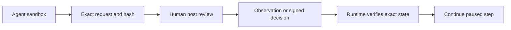

# Exact operator actions




| Component | Responsibility | Assurance limit |
| --- | --- | --- |
| JAI | Contract checks, protected-path hooks, signed exact-state L0 verification | Not universal OS isolation |
| Native provider | Effective sandbox and tool permissions | Prompts and projections are not independent host certification |
| Administrator | Protect public pin, private key, trusted helper and containment | Must remain outside agent-writable scope |
| Operator | Independently inspect and execute the exact action | Same UID or a keypress alone is not identity proof |
| Release owner | Git review, merge, tag, signing and publication | A render or Fabric receipt grants none of these |

## Routine execution first; self-contained human requests

A / AUTO is ordinary authorized work within the real native sandbox. B is an
observed native permission request. C is independent operator execution, not L0.
D is a formal consequential decision. A/B/C are execution routes; D is authority,
so D may precede C without turning every C action into a human decision.

Agents must run role-permitted pytest/build/WeasyPrint locally when possible.
Do not ask a human merely because a shell tool is involved. Reviewers never
write reviewed source: disable source caches or use explicitly native-writable
QA scratch. If the real read-only boundary cannot support the required output,
record the limitation and use an independent C action; never expand permissions.

Every B/C/D conversation request MUST give the category and FORMAL L0 YES/NO,
objective, exact observed reason (or honest policy/prerequisite), attempts and
alternatives, full command/workdir/input/output/privileges, sensitive/external
access, effects/reversibility and verification/resume steps inline. A request
file is secondary. If the reviewed signer/key location is only known on the
host, say COMMAND NOT READY and what the host operator must select; never ask
for private keys in chat or accept a chat approval as a credential.

### Local Chromium example — A when executable, otherwise observed C

For an execute-tier author in an authorized project, prepare approved static
HTML with no scripts/external URLs under build/local-qa. Use a disposable profile,
never a personal browser profile or a protected directory. Run inside the current
sandbox first (normal QA, no L0):

```sh
mkdir -p build/local-qa
printf '%s\n' '<!doctype html><html lang="en"><meta charset="utf-8"><title>Local QA</title><h1>Approved static QA page</h1></html>' > build/local-qa/page.html
chromium-browser --headless --disable-gpu --disable-background-networking --disable-extensions --no-first-run --hide-scrollbars --user-data-dir="$PWD/build/local-qa/profile" --screenshot="$PWD/build/local-qa/page.png" --window-size=1200,800 "file://$PWD/build/local-qa/page.html"
```

These flags do not grant OS containment or a network firewall. The actual native
filesystem/network restrictions remain decisive. Do not use sandbox-disabling,
web-security-disabling or unrestricted file-access flags. Untrusted HTML/JS is
not an approved local QA input and needs separate containment/review. Missing
Chromium is optional dependency absence, not L0.

If the actual error is socket() failed: Operation not permitted, the agent can
request C with the exact failing command adjusted only to an approved fresh host
profile/output. State that error, input hash, workdir and complete invocation
inline; say FORMAL L0: NO. Do not make the human find a command in this guide.
The operator returns exit status and PNG; JAI checks unchanged input, real image
and dimensions. This is an observation, not cryptographic execution attestation.
WeasyPrint can be a document-PDF alternative but does not prove Chromium layout.

## Conversation prompt

In Codex or Claude: “Prepare the exact request with IDs, input/state hashes,
policy, expiry, proposed effects and output paths; wait for returned evidence.”
This prompt is not authorization. Both providers remain in their native sandbox.

## Fabric: external operator L0

Use an actual engagement from the layered workflow; obtain its exact engagement
and escalation IDs from JAI's current status and human-handoff dossier. Ask JAI
to show these through its native session operations; do not invent IDs or query
files. Set the installed runtime location in the host terminal:

```sh
JAI_RUNTIME="$HOME/.ai/it-role-house"
```

When a change requires L0, JAI presents its dossier and uses the existing
`prepare_human` native operation
with the proposed effects. The user does not construct bootstrap JSON or invent
message IDs. With matching public enrollment, JAI returns a prepared package
containing unsigned-message.json, intent.json, request.json and exact
`external_actions` commands. Without enrollment it reports a readiness gap and
does not fabricate a signing package. Preparing a package grants no authority.

Inspect request_id, the planned effects and references, expected journal head,
policy digest, rationale and expiry. In the host terminal, set HUMAN_PACKAGE and
HUMAN_WORKSPACE to the exact package and workspace from JAI's handoff; set
FABRIC_HOME and ENGAGEMENT to its supplied journal directory and engagement.
These are actual values, not new directories or invented identifiers.

### Enrollment and signing: host operator only

**Fresh-host setup recipe: NOT_VERIFIED.** These commands are provided for
administrator review, not unattended setup. Existing reference enrollment and
signed decisions have been exercised separately; they do not establish this
recipe's execution or isolation on a new host. Verify the target before use.

The installer offers confirmed creation of the default Ed25519 private key at
`~/.local/share/jai-operator/private.pem`. Existing keys are preserved;
`--force-genkey` requires confirmation and retains a private backup. Neither
normal installation nor key replacement changes public enrollment. See
[human authority](human-authority.md) for confirmation, default/override signing,
public export and rotation behavior.

For current Gen2 decisions, the human separately enrolls purpose-specific public
keyrings under `$JAI_RUNTIME/trust/`: `jai-delivery-change-trust.json`,
`jai-delivery-accept-trust.json` and `jai-delivery-release-trust.json`. Their
schema is `schema_version: 3`, `policy_version: governed-keyring/1`, with the
exact purpose, approved authority/routing policy IDs and explicit key entries.
Each key needs a public PEM and its SHA-256 identity, signer, capabilities,
state, engagement/scope grants and validity window. Exactly one key is active
per purpose. The respective capabilities are `lifecycle-update`, `accept` and
`release`; none implies another. Choose actual policy IDs, grants and human
identity; an illustrative setup cannot decide them for you.

Existing enrollment must not be overwritten by an example or key generation.
Only public material is shared with JAI. Keep the private key and backups
outside agent mounts, and protect public enrollment against agent replacement
using the host's existing controls. A path, same UID or chat approval does not
establish that boundary. Missing enrollment leaves signed authority unavailable;
it does not prevent JAI from showing the actual dossier.

Review the installed signing helper before using JAI's exact host command:

```sh
python3 "$JAI_RUNTIME/tools/operator_actions.py" sign "$HUMAN_PACKAGE/request.json" --workspace "$HUMAN_WORKSPACE"
```

It uses the default key; append `--key "$OPERATOR_KEY"` for an explicitly chosen
alternative. Signing produces a public receipt, not a submitted journal decision.
Follow the prepared package's bind and submit commands afterward. No agent signs
or performs human trust enrollment.

Read the preview; type APPROVE followed by the displayed UUID, or DENY followed
by that UUID. Return only the public receipt path/hash. The receipt is written
beside the request under receipts/UUID.json. Set HUMAN_RECEIPT to the actual
printed receipt path. Use the package's exact bind and submit commands:

```sh
python3 "$JAI_RUNTIME/tools/governed_layered.py" bind-human --package "$HUMAN_PACKAGE" --receipt "$HUMAN_RECEIPT"
FABRIC_HOME="$FABRIC_HOME" python3 "$JAI_RUNTIME/fabric/fabric.py" submit "$ENGAGEMENT" --message "$HUMAN_PACKAGE/message.json" --authority-proof "$HUMAN_PACKAGE/proof.json"
```

Substitute actual UUID/IDs. Declining leaves the ledger unchanged; signing a
domain REJECT instead authorizes recording a rejection. Tamper, expiry, stale
snapshot/policy and replay deny; request again rather than editing signed data.
Binding verifies the public receipt without submitting a decision. After
submission, ask JAI to show the resulting native-session checkpoint and current
basis, or run its independent audit workflow. Missing relevant evidence still
blocks acceptance or release.
Assurance: LOCAL_OPERATOR_ATTESTATION, not enterprise IAM or nonrepudiation.
Local hash-chained records are not rollback-resistant/immutable custody.

## Render actual files

For the optional rendering examples below, review and copy the five helper
modules into a host-only directory. In the HOST terminal set REVIEWED_HELPER to
that directory. This minimal copy supports the `render` command only. Use the
installed runtime for `verify` and `resume-render`, as shown below; those
commands have additional dependencies. The rendering copy does not substitute
for the installed signer's purpose-specific trust configuration.

Provide Pillow in the host Python environment used by the helper: its visual-QA
module imports Pillow even when the renderer is an external program. Native
Office rendering also needs an Office-compatible renderer and Poppler for page
images. For HTML, provide the dependencies of the selected backend: a supported
WeasyPrint 70 CLI or Python module, or LibreOffice. SVG rendering uses CairoSVG.
Install the dependencies for the formats you will
render, following the [publication dependency matrix](../configuration/publication-stack.md#dependencies-by-task).
Copying these modules does not install their Python packages or host programs.

After choosing a NEW host-only REVIEWED_HELPER directory, the operator runs:

```sh
mkdir -m 700 "$REVIEWED_HELPER"
for module in operator_actions operator_keys runtime_dependencies office_renderer visual_qa; do
  sha256sum "$JAI_RUNTIME/tools/$module.py"
  cp -- "$JAI_RUNTIME/tools/$module.py" "$REVIEWED_HELPER/$module.py"
  sha256sum "$REVIEWED_HELPER/$module.py"
done
```

Compare each pair with the reviewed release's source inventory before rendering.
The copy has no key and must not remain writable by model-controlled tools.

If HTML/PDF rendering uses the WeasyPrint Python-module fallback, provide
WeasyPrint 70 and its dependencies in that interpreter. A working OS-provided
package is acceptable; Pyphen is normally installed automatically. The
[clean renderer environment](../getting-started/install.md#a-clean-optional-renderer-environment)
is an optional pip recipe if isolation is needed. A working CLI needs no
duplicate Python packages; `html-auto` can select LibreOffice when WeasyPrint
is unavailable. Use the selected Python for `html-auto` requests when the
Python-module fallback is needed. Every OS first tries the
WeasyPrint 70 CLI on PATH with deny-all resource options; the current Python
module is the fallback for CLI absence, incompatible version or startup failure.
No OS-specific interpreter discovery or duplicate packages are needed. Doctor
uses actual conversion and reports the selected execution mode. A Pyphen
version is informational; resource denials and conversion failures never cause
a weaker fallback.

Portable requirements: renderer libraries/fonts, Poppler pdftoppm, and an actual
Office renderer for Office files. Fedora host package proposal (operator only):

```sh
sudo dnf install libreoffice poppler-utils openssl dejavu-sans-fonts
```

This changes host packages, not Fabric authority. Use normal-user rendering;
untrusted Office files require suitable host containment and no unnecessary
elevation. Do not broaden provider network/sandbox permissions for LibreOffice.
For a real generated draft.docx in the project:

```sh
python3 "$JAI_RUNTIME/tools/operator_actions.py" prepare-render draft.docx --out operator/docx.json
sha256sum draft.docx operator/docx.json
```

Exit 3 / OPERATOR_ACTION_REQUIRED is expected. The operator checks the request
and input hash, then runs the reviewed helper outside the agent sandbox:

```sh
python3 -I -c 'import sys;sys.path.insert(0,sys.argv.pop(1));import operator_actions;sys.exit(operator_actions.main())' "$REVIEWED_HELPER" render "$PWD/operator/docx.json" --workspace "$PWD"
python3 "$JAI_RUNTIME/tools/operator_actions.py" verify operator/docx.json operator/receipts/UUID.json
```

Actual PDF/page images are under operator/outputs/UUID. Receipt entries contain
input/output SHA-256, tool/version, profile, command and actual pages. Inspect
the actual PNGs. Repeat for PPTX/XLSX; HTML screenshots cannot establish Office
fidelity. For real draft.html use prepare-render with --backend html-auto:
optional WeasyPrint 70 performs constrained HTML/PDF conversion, not Office QA.

Generic prepare-render requests have no completion_target. Only publication's
PDF handoff creates that field; resume that exact request after verification:

```sh
python3 "$JAI_RUNTIME/tools/operator_actions.py" resume-render PUBLICATION_REQUEST.json RECEIPT.json --workspace "$PWD"
```

Substitute returned paths. Input drift requires a new request; changed completion
targets need reconciliation. Declined actions are DENIED, missing/failed outputs
UNAVAILABLE. An unperformed host action is PENDING, not fictional PASS. Render
receipts are unsigned observations, never Fabric L0 credentials.

## Human development and readiness

Agent direct .git writes remain prohibited. In a disposable repository the human
may review a proposal with expected HEAD, branch, explicit paths and message,
then run git switch -c documentation-example, git add -- draft.docx and
git commit with a reviewed message. Tag/push/publication are separate owner acts.
There is no unrestricted command executor or agent Git bypass.

```sh
python3 "$JAI_RUNTIME/tools/operator_actions.py" doctor
```

Doctor reports actual checks, READY / OPERATOR_ACTION_REQUIRED / UNAVAILABLE,
not certification. Fedora + Codex is the reference; other systems need their
own renderer/rasterizer/fonts. macOS/Windows local trust adapters and live Claude
confinement remain NOT_VERIFIED. Optional hardening is OPTIONAL_HARDENING.
Privileged worker/broker/API/MCP mutation is NOT_SUPPORTED; Host/provider isolation remains deployment-dependent and NOT_VERIFIED. Normal authorized workspace authoring is SUPPORTED; reviewer write
denial is contract/native projection evidence, not measured OS process isolation.
