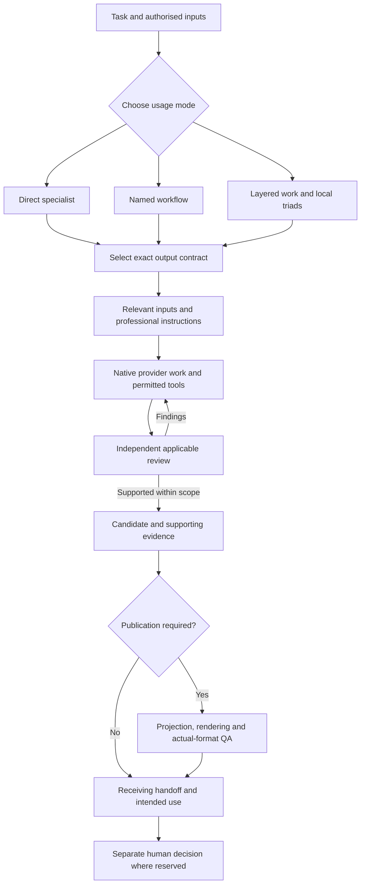

# Execution and context assembly

JAI coordinates native provider reasoning, professional instructions, explicit
output contracts and recorded review. It uses the active Claude Code or Codex
session rather than running a separate language model. A procedure or generated
provider file describes intended behaviour; the actual host invocation and
returned work establish what happened in an engagement.

## Choose the scope of work

Choose one of the [three usage modes](../using/usage-modes.md): a direct role for
bounded specialist work, a named workflow for its maintained process, or the
layered matrix for cross-perspective justification. These are alternative entry
points, not three engines that every task must traverse.

The role router matches the requested deliverable to the full catalogue and
checks the candidate's scope. Professional role selection is distinct from
provider/model selection. A free-form request is not automatically intercepted
and transformed into a complete matrix run; use the appropriate workflow entry.

## Current layered model

Gen2 uses the SABSA content perspectives **Contextual, Conceptual, Logical,
Physical, Component and Management**, each addressing What, Why, How, Who, Where
and When. Management concerns are crosscutting. L0 is external human authority,
not a seventh AI layer. See the [layer model](../architecture/sabsa-layer-model.md).

An incoming handoff addresses the receiving layer's outcomes and interfaces.
Its local setter formulates questions and criteria; the author and independent
reviewer work within that layer. Each entity selects its own suitable
specialties and available model resources. Integration review and receiving
handoff acceptance follow the question reviews.

The arrows describe an operating sequence. They do not assert automatic calls,
acceptance of every output, or permission to perform a reserved decision.

## Select the applicable content

The registered role-output ID selects an explicit content specification. Its
shared foundations and overlays form the effective contract. Required,
conditional, optional and prohibited information remains distinct; unknown
applicability must be resolved rather than treated as false. See the
[output contract catalogue](../reference/output-contracts/index.md).

The existing `ContentSpec.resolve()` and `compile()` functions assemble typed
information obligations from the registered binding. Their output is a blueprint,
not proof that a document, implementation or observation fulfils it. Expert
references are illustrative authoring material; fictional names, calculations
and evidence identifiers must not become project facts.

## Supply a bounded professional context

For native layered work, the parent obtains an issued task-specific context,
delegates through the provider's native facilities and captures the returned
result. The runtime binds the actual capture to the issued assignment and
context before admitting its semantic effects. See [native execution](../architecture/gen2-native-execution-bridge.md).

Each task receives the relevant input sections and immutable attachment
references. An author and reviewer have separate professional contexts. The
whole journal and the complete role catalogue are not copied into every prompt;
the catalogue remains available for local staffing. Missing neighbour-owned
material is requested explicitly. General reference access and catalogue access
must not become a restrictive role whitelist.

A professional selection plan remains reusable while its governing assignment
and inputs remain unchanged. Mechanical continuation does not require another
model selection or another execution of completed work. On restart, reconcile
prepared intents, actual handles and admitted results before issuing new work.
Unobserved completion remains unresolved; cancellation alone does not prove that
a physical invocation terminated.

## What the components establish

| Component | Result and boundary |
| --- | --- |
| Role and workflow definitions | Professional scope, expected outputs and handoff gates; not proof of execution |
| Model routing and agent configuration | Available provider/workload mapping and native tool contract; not professional role authority |
| Content specifications and domain validators | Explicit obligations and located findings; structural success is not professional semantic acceptance |
| Native execution bridge and dispatcher | Issued context, actual capture and permitted semantic effects; no claim about hidden provider state beyond observed capabilities |
| Lifecycle Store and governed messages | Immutable identities, explicit dependencies, atomic decisions and scoped current applicability |
| Projection, publication and visual QA | Audience-specific rendition and evidence for the actual formats inspected; no acceptance or release grant |
| External operator signing | Proof of an exact reserved human decision, subject to scope, expiry, replay and current-state checks |

The current Fabric facade uses `validate --message`,
`submit engagement-id --message` and `current-basis engagement-id --query`.
Read-only assessment commands use the same exact query boundary. Normal users
do not construct these messages: the native parent handles transport. See the
[protocol](../reference/governed-delivery-protocol.md) and
[maintainer operating guide](../operations/normal-layered-workflow.md).

## Evidence and decision boundaries

Source references identify what the work used; they do not make every source
assertion true. Record observed facts, assumptions, unknowns and unexecuted work
accurately. Material claims need the evidence required by the selected contract.

A changed input creates a new version and an explicit owner decision about
applicability. A previously supported answer or review does not automatically
transfer. Continued work, receiving acceptance and release permission remain
separate. Assess the exact output's relevant dependencies rather than repeatedly
revalidating unrelated historical records. See
[versioned applicability](../architecture/governed-runtime-cutover.md).
