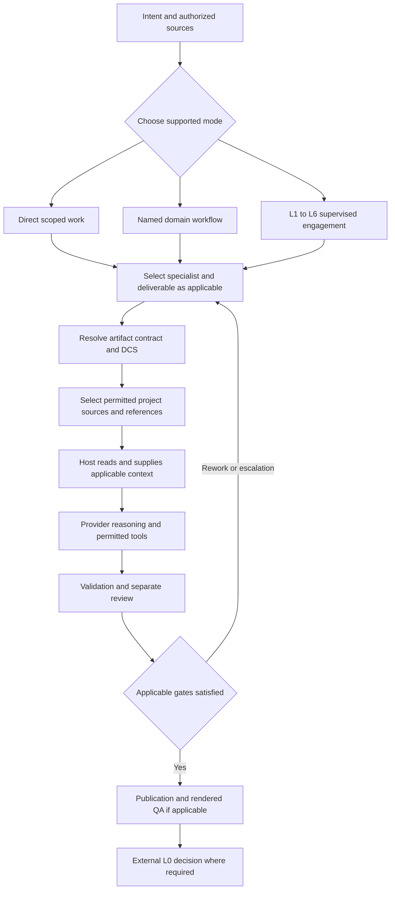

# Execution and context-assembly algorithm

Owner: JAI maintainers · Last reviewed: 2026-10-20

This explanation is grounded in the JAI 26.10.12 source. JAI coordinates
provider-hosted reasoning, specialist instructions, typed deliverables,
evidence and review. It does not implement a separate language model.
The flow describes supported operations and operating procedures; it is
not a universally enforced interceptor for every conversational request.

[Experimental hint support](../using/experimental-hint.md) helps choose a
starting procedure from maintained examples. Its lexical metadata selection
and procedural explanation do not establish universal routing, physical
loading of a referenced document, or delivery of that document to a model.

## Reading implementation status

| Label | Meaning on these pages |
| --- | --- |
| `IMPLEMENTED` | Confirmed in the named repository component; deployment or execution still needs evidence. |
| `PROCEDURAL` | An agent/workflow instruction that the operator must actually follow. |
| `PROPOSED` | A possible enhancement, not a new normative requirement or roadmap commitment. |
| `NOT VERIFIED` | Available evidence does not establish the claimed deployment or execution. |
| `NOT IMPLEMENTED` | The described mechanism is absent from the inspected supported path. |

Source inspection establishes capability, not that a particular provider
session executed it. Installed configuration, actual reads and provider
invocation evidence are different observations.

## Choose the operating mode

**PROCEDURAL:** `.ai/agents/role-router.md` directs the router to
consult `roles.json`, match the requested deliverable, inspect candidate
role scope and select its operator. It does not perform the specialist's
work. `.ai/runtime/roles.json` and `workflows.json` describe available
roles, workflow steps and handoffs; their presence does not run a
workflow.

Use direct work for a bounded task, a named domain workflow for its
defined procedure, or a supervised layered engagement for consequential
work. These are alternatives, not three mandatory engines in sequence.
See [interaction patterns](../using/interaction-model.md) and [workflow
selection](../using/methodical-workflows.md).

**NOT IMPLEMENTED:** a universal entry interceptor that forces every
free-form request or direct role invocation through role routing and
L1–L6 supervision. Deployment policy can require that path; this does
not prove technical enforcement at every entry point.

## Execution layers and authority

The execution layers are L1 Intent and Context, L2 Meaning and Domain
Model, L3 Reasoning, Policy and Control, L4 Solution Design, L5
Realisation and Tooling, and L6 Execution and Evidence. L0 Human
Authority is external, not a seventh AI layer. SABSA coordinates
describe a separate domain method and do not renumber these execution
layers.

Arrows describe a controlled operating sequence, not automatic calls.
Configured pre-tool hooks run before relevant tool execution; post-tool
hooks run afterwards. They are not activated by every prose response.
Publication and human decisions apply according to the chosen contract.

## What each component establishes

| Step | Implemented component or procedure | Observable output and boundary |
| --- | --- | --- |
| Establish intent | User scope and workflow instructions (`PROCEDURAL`) | Purpose, audience, acceptance and unknowns; source assertions are not automatically true. |
| Select specialist | Role-router instruction (`PROCEDURAL`) | Specialist/operator choice; model selection is a separate concern. |
| Select deliverable | Artifact Contract v3 registry and `artifacts.py` (`IMPLEMENTED`) | Stable identity and transfer/review contract, not completed content. |
| Resolve obligations | `ContentSpec.resolve()` and `compile()` (`IMPLEMENTED`) | Registered binding, typed units, applicability and compiled hash; no inferred role authority from standalone kind selection. |
| Select examples | `ExpertReferences.canonical_family()` and `resolve()` (`IMPLEMENTED`) | One validated reference file and sanitized selection report, not a provider prompt. |
| Supply context | Role-author reading/handoff instruction (`PROCEDURAL`) | Actual host reads must supply selected files; discovery alone proves no LLM consumption. |
| Select provider configuration | `model_router.py` and `agent_runtime.py` (`IMPLEMENTED`) | Workload/model mapping and agent tool contract; actual host invocation remains separate. |
| Record layered work | Fabric contract, packet, ingest and review APIs (`IMPLEMENTED`) | Digest-bound records and explicit review transitions, not proof of hidden provider context. |
| Validate content | `content_lint.evaluate()` and domain validators (`IMPLEMENTED`) | Structured findings against applicable rules; synthetic tests do not establish professional truth. |
| Publish | `projection.build()`, `publication.py`, `visual_qa.py` (`IMPLEMENTED`) | Manifest-bound presentation and actual render checks; neither grants L0 authority. |

The Artifact Contract v3 source is
`.ai/runtime/artifacts/contracts/role-deliverables.v3.json`.
`artifacts.py:validate()` checks registry consistency. Content
obligations come from `.ai/runtime/content/registry.json` and its
registered bindings; they are not interchangeable with the artifact's
interface and ownership. Current compiled DCS objects carry
proposed/advisory status. They do not activate new normative enforcement
merely because an example is selected.

## Role routing versus model routing

**IMPLEMENTED:** `model_router.py:effective_registry()` combines the
bundled model registry with a configured override. `resolve()` validates
the provider/workload class and returns its model mapping; `candidates()`
exposes primary and configured fallback choices. These functions neither
choose the professional role nor execute a model retry loop.

`agent_runtime.py:provider_config()` projects the Agent Contract into
Claude/Codex tool, sandbox and model settings, including native Codex
model/reasoning fields. `authorize()` checks requested operations against
enterprise policy and the contract. The installer renders provider-facing
skills, agents and configuration from these sources. File generation is
not proof that the host used the configuration for a particular call.
See [provider/model configuration](../configuration/models.md).

## How context reaches a provider

**PROCEDURAL:** `.ai/agents/role-author.md` instructs the operator to
resolve a supported reference and read the selected file through a
private handoff. It requires an execution-capable operator when the
author role cannot run the resolver. User project inputs, controlling
policy, role instructions and compiled DCS must be supplied through the
actual host's supported messages, skills or tool results.

**IMPLEMENTED:** Fabric's `contract_context_packet()` in
`.ai/runtime/fabric/fabric.py` builds the intended contract packet and
digest. `render-contract` and `context-packet` expose it; protocol 3.3
ingestion rejects a missing or mismatched echoed context digest. The
layered skill instructs dispatch with that packet alone. This records
the intended dependency boundary; it cannot prove that the provider
added no system instructions, previous messages or other context.

**NOT IMPLEMENTED:** one general runtime function that automatically
assembles task, roles, DCS, project facts and reference excerpts into
every LLM request with a verified token budget. A narrowly scoped
optional provider-evaluation harness does construct whole-file prompts;
it is not the normal authoring engine. See [reference selection and
context delivery](../reference/reference-selection-context.md).

## Evidence, review and publication boundaries

Expert examples are AI-authored proposed illustrative content. Their
people, prices, controls and evidence identifiers must not become
project facts. Project sources need attribution and applicable access
controls; missing evidence remains unknown, pending or not executed.
Source priority does not authorize lower-trust prose to override policy
or tool limits.

Fabric records and execution digests support audit within their recorded
scope. Separate review, SoD and external human authority remain required
where applicable. AI editorial review is not independent human approval.
A successful render or CI gate does not accept business risk or
authorize use of a project deliverable.

See [layered runtime](../capabilities/layered-runtime.md),
[publication](../capabilities/artifacts-publication.md) and [hooks and
release controls](../configuration/hooks-gates-verification.md).
