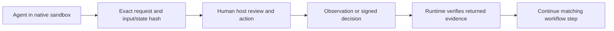

# Human authority, operator workflows and security boundaries

Current support is declared only in the package `RELEASE-SCOPE.json`.
Generated release inventories derive their scope and feature list from it;
these workflow explanations do not create additional capabilities or grants.

Owner: JAI maintainers. Last reviewed: 2026-10-26.

JAI augments enterprise IS/IT work with specialist workflows, traceable evidence
and editable deliverables. AI prepares; people retain consequential decisions.
The six processing layers are L1–L6. L0 is external human authority, not another
agent. Ordinary authorized workspace authoring does not require signing keys.

## Execution route and decision authority

A/B/C describe HOW an operation executes. D describes WHO must decide. They are
not four permission levels or a new authorization hierarchy. A workflow can
require a formal D decision before a separate C host action; C alone never
implies D. Classify effect, target, actor/role, effective sandbox and input trust,
not the executable name alone.

| Category | Meaning | Example |
| --- | --- | --- |
| A / AUTO | Role-authorized work inside the existing effective sandbox | Local reads, allowed edits, pytest/lint/build, trusted local screenshots, WeasyPrint |
| B / PROVIDER_APPROVAL | An actually requested native provider permission; never auto-escalate | A specific Codex/Claude tool prompt, not Fabric L0 |
| C / OPERATOR_EXECUTION | Human independently performs an exact host action unavailable/inappropriate inside the sandbox | Observed Chromium IPC denial, host LibreOffice or system dependency installation |
| D / FORMAL_L0 | External consequential decision using existing signed exact-state Fabric verification | Accepting residual risk or an accountable architecture decision |

Try authorized local work autonomously first. Unknown capabilities are not a
reason to invent a denial or ask for L0. A missing optional binary is a missing
dependency, not a security approval requirement. Unknown privileged/external
mutations remain denied; operator handoff is not an override of forbidden scope.
Native provider approval and a host task are neither a signed Fabric decision
nor release-owner publication authorization.

Every JAI-generated B/C/D request must contain a complete inline explanation
BEFORE any detail link: category, prominent FORMAL L0 YES/NO, purpose, observed
reason, prior attempts/alternative, exact command and working directory, input/
output paths/hashes, privileges, risks/external access/side effects/reversibility,
and returned evidence/verification/resumption. If a command is not ready, state
exactly what is missing; never substitute a document link or invented command.
The existing operator_actions formatter only displays data, never executes
arbitrary shell text. A chat response cannot authorize Fabric L0.

See the [complete operator walkthrough](../operations/operator-walkthrough.md)
for actual commands, key prerequisites, approval/decline and returned evidence.

## Supported capabilities and limits

| Capability | Current state and responsibility |
| --- | --- |
| Roles, workflows, SABSA/EA, Fabric and editable artifacts | SUPPORTED within authorized project scope; professional review remains necessary |
| Workspace authoring | SUPPORTED within effective native provider/host permissions |
| Reviewer writes | JAI contract and native projections deny Write/Edit; hooks add checks. This is not independent OS process-confinement certification |
| Protected Git metadata, policy, approvals and key stores | JAI denials and native/host protections must remain effective; never grant blanket writes to make a task work |
| Human Git | SUPPORTED outside the agent sandbox; no privileged agent Git service |
| Formal local L0 | OPERATOR_ASSISTED with external Ed25519 key, reviewed signer and protected public pin |
| HTML/PDF | Optional WeasyPrint 70 with constrained resources, or explicit host-render handoff |
| Actual DOCX/PPTX/XLSX visual QA | A if the real Office renderer works within the allowed sandbox; otherwise C / OPERATOR_ASSISTED; HTML PDF is not a substitute |
| Autonomous privileged host/API/MCP/release mutations | NOT_SUPPORTED; unavailable worker/broker facilities are not enabled by prompts or CLI flags |
| General host/provider confinement certification | NOT_VERIFIED; depends on deployment, not role text or a generated config |

These limitations are intentional disclosure, not a claim that removed security
backends became operational. The machine-readable release scope and exact ZIP
qualification preserve technical assurance references separately from this guide.

## From request to continuation



Requests bind operation, purpose, input/hash, target, parameters, permissions,
risk, expiry and expected outputs. No arbitrary-command executor is provided.
The lifecycle is OPERATOR_ACTION_REQUIRED, then verified COMPLETED, DENIED or
UNAVAILABLE. Changed input requires a new request. Ambiguous or changed output
needs reconciliation; the runtime must not assume success or silently repeat work.

For example, if LibreOffice cannot run inside the sandbox, the human uses the
reviewed host renderer for the exact document. JAI verifies source/output hashes,
renderer/version and actual page evidence before continuing. Do not broaden
provider network or filesystem access merely to make Office rendering work.
[Publication configuration](../configuration/publication-stack.md) distinguishes
independent HTML/PDF from actual-format Office QA.

## Local operator attestation

The external human reviews object IDs, full planned ledger effects, snapshot,
policy digest, rationale, consequences and expiry before signing or declining.
Fabric verifies the Ed25519 receipt and current state before atomic application.
Missing, forged, stale, expired and replayed approvals deny. Declining leaves the
ledger unchanged; approving a domain REJECT decision instead records a rejection.

Keep the private key and reviewed signer outside agent-accessible/writable
mounts. The administrator-enrolled public pin is protected against replacement;
it is verification data, not an API key. The installer generates no L0 key.
A chat message, native tool prompt, signer label, environment flag, same OS UID
or keypress alone is not an authorization credential.

Assurance is LOCAL_OPERATOR_ATTESTATION. It is not enterprise IAM or independent
nonrepudiation. Local hash-chained ledgers and content-hashed ExecutionRecords
remain writable local records, not immutable or rollback-resistant audit custody.
Detecting rollback requires separately protected external evidence retention.
Historical HMAC integrity alone does not grant new human L0 authority.

## Role-authorized local tools

Shell availability follows the actual AgentContract and the effective native
sandbox, not a blanket ban on AI shell use. Execute-tier role-engineer and the
existing publication/repository engineers can run their local QA tools. Pure
author-tier role-author has no Bash grant; route execution to the existing
execute-tier role instead of broadening that role or asking the human for L0.

Codex codebase-reviewer retains Bash with a requested read-only native profile.
Reviewed source/policy/approvals remain unwritable. QA evidence may use ONLY
explicitly native-writable build/temporary scratch; do not widen source access
for a cache. Claude reviewer Bash remains unavailable in the default projection:
its ordinary sandbox does not establish read-only reviewed source. A separate
independently configured boundary would need verification before that changes.
No generated JSON or skill frontmatter proves that native restrictions loaded.

## Provider and host responsibilities

| Layer of control | Responsibility | Limitation |
| --- | --- | --- |
| JAI | Typed contracts, denial hooks, evidence checks and exact signed L0 verification | Application checks do not create an OS boundary |
| Native provider | Enforce actual sandbox and tool configuration | Projections must really be loaded; provider versions/capabilities differ |
| Host administrator | Protect credentials, trusted code/pins, filesystem and network boundaries | Binary presence or generated configuration is not proof of enforcement |
| Human operator | Independently inspect and execute only the agreed host action | Operator activity does not grant the model broader host rights |
| Release owner | Review Git, signing and publication independently | Neither a rendering receipt nor a local Fabric decision publishes a release |

Fedora Linux + Codex is the reference environment. Core Python/data workflows
are portable, but macOS, Windows, WSL and Claude have distinct deployment limits.
Their local trust adapters and live confinement are NOT_VERIFIED; no equivalent
security certification is implied. See [sandbox prerequisites](../getting-started/sandbox-prerequisites.md).

## Optional hardening and readiness

An administrator can review these OPTIONAL_HARDENING measures without JAI
installing services or changing provider settings automatically:

- Verify which native sandbox/profile is actually active; retain protected
  Git, policy, credential and approval paths and least-privilege network access.
- Keep trust configuration, signing keys and reviewed helper code outside model
  writes; ensure private keys cannot be read by model-controlled tools.
- Render untrusted Office files with appropriate host containment and without
  unnecessary elevation. Keep renderer/font dependencies updated.
- Protect audit/evidence copies separately if rollback detection is required.
- Test real denied and authorized operations on the target host before making
  stronger isolation claims. Do not infer enforcement from a successful probe.

For a normal Linux installation, the diagnostic command is:

```sh
python3 ~/.ai/it-role-house/tools/operator_actions.py doctor
```

It reports actual checks and READY, OPERATOR_ACTION_REQUIRED or UNAVAILABLE,
with unverified confinement explicitly distinguished. It does not enroll keys,
change host settings or certify a sandbox. For first use see
[installation and optional capabilities](../getting-started/install.md); for
failure handling see [troubleshooting](../operations/troubleshooting.md).
